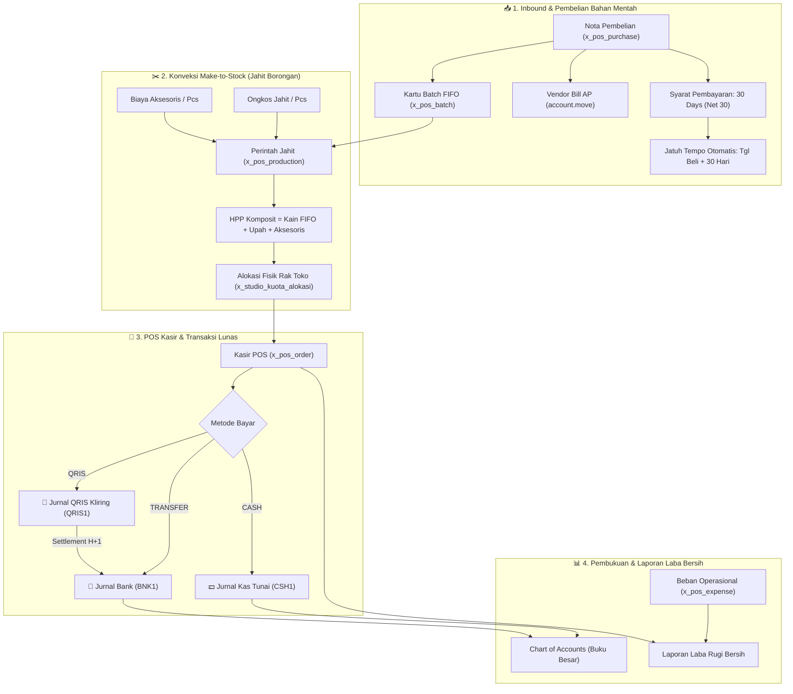
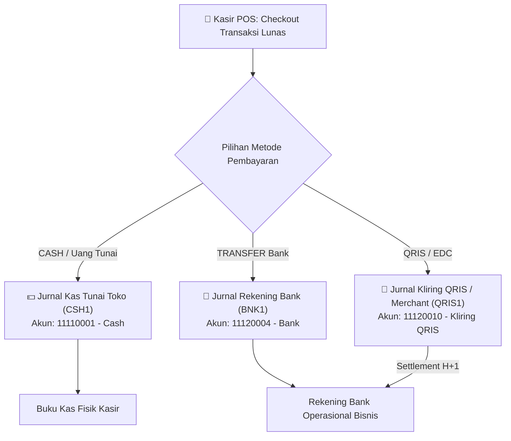
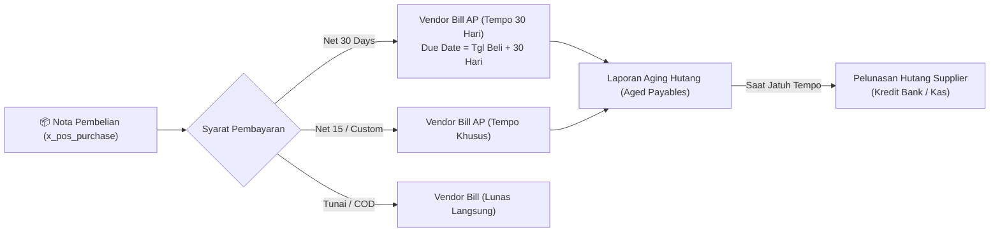
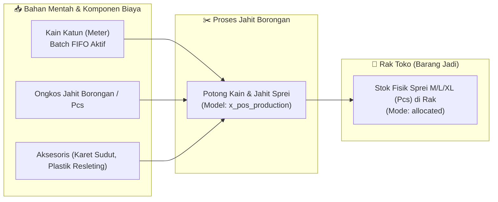

# Invo. • Sistem POS, Manajemen Inventori FIFO & Konveksi Terpadu

Sistem POS & Inventori Enterprise untuk bisnis ritel, grosir, dan manufaktur konveksi/tekstil/sembako dengan pelacakan modal berbasis **FIFO Murni (First-In, First-Out)**, konversi multi-satuan dinamis, dual-mode pengelolaan stok (*Physical Allocation* vs *Floating Pool*), **produksi jahit borongan sprei (Make-to-Stock)**, **multi-jurnal kasir (Kas vs Bank vs QRIS)**, serta **pembelian supplier dengan termin tempo (Net 30)** yang terintegrasi aktif dengan **Odoo 20.0 Enterprise Cloud (`sage.odoo.com`)**.

---

## 📌 Rangkuman Arsitektur Sistem (v2.2.0)

| Komponen | Spesifikasi & Teknologi |
| :--- | :--- |
| **Versi Sistem** | **v2.2.0 (Dual-Stack Architecture)** |
| **Tanggal Pembaruan** | 11 November 2026 |
| **Status Cloud Server** | **LIVE & OPERATIONAL** di `https://sage.odoo.com` |
| **Core Engine Local** | Node.js, Express.js, Knex.js, SQLite (better-sqlite3), Vanilla JS SPA, Theme Invo. Modern SaaS |
| **Modul Terpasang / Terintegrasi** | `invo_pos` (Custom Module v2.2.0), `account` (Invoicing & Accounting Enterprise), Odoo Studio ORM, Python Server Automations (`base.automation` + `ir.actions.server`) |
| **Model Kustom Odoo** | `x_master_barang`, `x_master_barang_line_022fd`, `x_pos_supplier`, `x_pos_purchase`, `x_pos_purchase_line`, `x_pos_batch`, `x_pos_order`, `x_pos_order_line`, `x_pos_expense`, `x_pos_production` |
| **API Endpoints** | RESTful JSON Controller (`/api/invo_pos/items`), XML-RPC (`/xmlrpc/2/object`), JSON-RPC (`/jsonrpc`), Odoo MCP AI Protocol |

---

## 🌟 Fitur Utama & Logika Bisnis Terpadu



---

### 1. 🏛️ Tahap 1: Integrasi Modul Akuntansi (`account`) & Multi-Jurnal Kasir

Sistem kasir POS terhubung langsung ke pembukuan formal Odoo melalui **3 Jurnal Pembayaran Terpisah**:



1. **Jurnal Kas Tunai (`CSH1`):** Menampung transaksi penerimaan uang tunai di kasir toko beserta kalkulasi uang kembalian secara reaktif.
2. **Jurnal Rekening Bank (`BNK1`):** Menampung pembayaran via transfer langsung ke rekening bank usaha (BCA/Mandiri/BRI).
3. **Jurnal QRIS & EDC Merchant (`QRIS1`):** Menampung pembayaran kode QRIS dinamis/statis ke akun perantara `11120010 - Kliring QRIS & EDC Merchant` yang secara otomatis ter-settle ke rekening bank pada $\text{H}+1$.

---

### 2. ⏳ Tahap 2: Manajemen Hutang Supplier, Termin Tempo (Net 30) & Vendor Bills

Restock pembelian bahan mentah mendukung syarat pembayaran tempo (*Accounts Payable*) dengan pelacakan jatuh tempo otomatis:



* **Field Terintegrasi pada Formulir Pembelian:**
  * **`x_payment_term_id`**: Terhubung ke `account.payment.term` (`Immediate Payment`, `15 Days`, `30 Days`, dll.).
  * **`x_due_date`**: Dihitung otomatis: $\text{Tanggal Pembelian} + \text{Hari Termin}$.
  * **`x_payment_state`**: Indikator status hutang (🔴 `not_paid` = Belum Dibayar, 🟡 `partially_paid` = Dibayar Sebagian, 🟢 `paid` = Lunas).
  * **`x_invoice_id`**: Dokumen faktur tagihan supplier resmi (*Vendor Bill*) pada model `account.move`.
* **Automasi Server Action 238:** Saat status PO diubah menjadi `done`, sistem otomatis membentuk dokumen *Vendor Bill* dengan akun pemasok terdaftar di buku hutang dagang Odoo.

---

### 3. ✂️ Tahap 3: Konveksi Make-to-Stock & HPP Komposit (Jahit Borongan Sprei)

Bagi bisnis konveksi tekstil sprei, kain mentah diolah terlebih dahulu secara borongan menjadi stok fisik sprei siap jual di rak toko sebelum ditransaksikan kasir (*Make-to-Stock*).



#### Formula Matematis HPP Komposit Terkunci:
$$\text{HPP Modal Sprei Jadi} = (\text{Kebutuhan Kain} \times \text{HPP FIFO Kain Aktif}) + \text{Ongkos Jahit Borongan} + \text{Biaya Aksesoris}$$

* **Simulasi Perhitungan Kasus Sprei XL (Batch 1 FIFO @ Rp 20.000/meter):**
  * Kebutuhan Kain: 3.0 Meter $\times \text{Rp } 20.000 = \text{Rp } 60.000$
  * Ongkos Jahit Borongan per pcs: $\text{Rp } 10.000$
  * Biaya Aksesoris (Karet Sudut + Plastik Kemasan): $\text{Rp } 5.000$
  * **Total HPP Terkunci per Pcs:** $\text{Rp } 60.000 + 10.000 + 5.000 = \mathbf{\text{Rp } 75.000 / \text{pcs}}$.
  * **Harga Jual Margin 50%:** $\text{Rp } 75.000 \times 1.5 = \mathbf{\text{Rp } 112.500}$.
  * **Automasi Eksekusi (Action 473 & Rule 5):**
    1. Memotong $30\text{ meter}$ dari batch FIFO aktif kain mentah.
    2. Mengubah varian ke mode `x_studio_mode_stok = 'allocated'` (Alokasi Fisik Rak).
    3. Menambahkan kuota $+10\text{ pcs}$ ke `x_studio_kuota_alokasi` dan `x_studio_stok_siap_jual`.
    4. Mengunci harga jual katalog varian ke Rp 112.500.

---

### 4. 🌐 REST API Controller Master Barang & Dynamic HTML Viewer

Modul `invo_pos` menyediakan antarmuka REST API publik dengan dukungan CORS (`Access-Control-Allow-Origin: *`):
* **`GET /api/invo_pos/items`**: Mengambil daftar seluruh master barang, satuan dasar, stok gudang, dan rincian varian satuan jual.
* **`GET /api/invo_pos/items/<id>`**: Mengambil rincian 1 master barang lengkap dengan kartu persediaan batch FIFO aktif (`fifo_batches`).
* **`POST /api/invo_pos/items`**: Membuat master barang baru beserta varian via payload JSON.
* **Dynamic HTML Viewer ([invo_pos_items_viewer.html](invo_pos_items_viewer.html)):** Antarmuka web modern dengan tema SaaS Invo. untuk melihat katalog barang dinamis, metrik statistik real-time, pencarian instan, dan drawer kartu batch persediaan FIFO.

---

## 🛠️ Struktur Repositori & Berkas Terkait

```
Odoo/
├── invo_pos/                        # Modul Standalone Odoo (v2.2.0)
│   ├── __manifest__.py              # Manifest module (Depends: base, web, account)
│   ├── models/                      # Model Bisnis (Item, Unit, Batch, Order, Purchase, Expense, Production)
│   │   ├── production.py            # Model Produksi Jahit Sprei (Make-to-Stock)
│   │   ├── purchase.py              # Model Pembelian dengan Syarat Pembayaran & Vendor Bill
│   │   └── ...
│   ├── views/                       # XML Views
│   │   ├── production_views.xml     # Form & Tree View Produksi Jahit Sprei
│   │   ├── purchase_views.xml       # Form & Tree View Pembelian dengan Termin Tempo
│   │   ├── menu_views.xml           # Menu Terintegrasi (Kasir, Katalog, Konveksi, Pembelian, Biaya)
│   │   └── ...
│   ├── controllers/                 # REST API Controllers (main.py)
│   └── security/                    # Hak Akses (ir.model.access.csv)
├── invo_pos.zip                     # Arsip Modul Siap Pasang (Clean Archive)
├── invo_pos_items_viewer.html       # Web Viewer Dinamis REST API
└── TokoJendral/                     # Repositori Spesifikasi & Dokumentasi
    ├── README.md                    # Dokumentasi Utama Sistem (v2.2.0)
    └── docs/
        └── PRD.md                   # Product Requirements Document (PRD v2.2.0)
```

---

## 🚀 Panduan Akses & Uji Coba di Odoo Cloud

1. **Akses Instance Odoo:**
   - **URL:** [https://sage.odoo.com](https://sage.odoo.com)
   - **Database:** `sage`
   - **User:** `hanindyo.kusuma@yahoo.co.id`
2. **Menu Utama Terpasang:**
   - `Invo. POS` -> `🛒 POS Kasir & Transaksi`
   - `Invo. POS` -> `✂️ Produksi & Jahit Sprei` *(Fitur Baru v2.2.0)*
   - `Invo. POS` -> `Pembelian & Restock Inbound` *(Termin Net 30 & Vendor Bills)*
   - `Invo. POS` -> `Master Barang & Satuan Jual`
   - `Invo. POS` -> `🛠️ Reset & Muat Sample Flow`
3. **Membuka HTML Viewer Dinamis:**
   - Klik ganda berkas [invo_pos_items_viewer.html](invo_pos_items_viewer.html) pada peramban web untuk melihat data master barang yang diambil secara dinamis.
