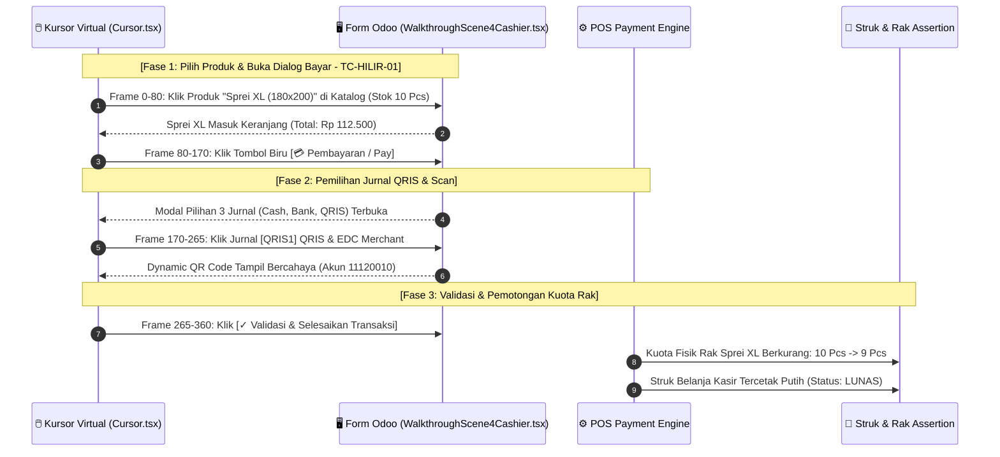

# 📋 DECISION TABLE TEST CASES (TAHAP 3: HILIR)
## Transaksi Kasir POS, Pengurangan Stok Rak, Multi-Payment Split, & Cetak Struk

Dokumen ini disusun menggunakan metodologi **Senior QA Test Design Techniques (ISTQB Standard)** untuk memetakan seluruh kombinasi logika bisnis pada outlet kasir penjualan, pemotongan stok fisik rak toko, dan pemisahan buku jurnal transaksi kasir (Cash, Bank, QRIS EDC).

---

## 1. 📐 Matriks Tabel Keputusan (*Decision Table Matrix*)

### Kuadran Kondisi (*Condition Stub & Entries*) dan Aksi (*Action Stub & Entries*)

| Kode | Kondisi / Aksi (*Conditions & Actions*) | Rule 1 (R1) ⭐ *Full QRIS* | Rule 2 (R2) *Cash + Change* | Rule 3 (R3) *Full Bank* | Rule 4 (R4) *Split Cash+QRIS* | Rule 5 (R5) *Underpaid (Kurang)* | Rule 6 (R6) *Out of Stock (0)* |
| :--- | :--- | :---: | :---: | :---: | :---: | :---: | :---: |
| **C1** | Stok Fisik di Rak Kasir Tersedia ($>0$)? | **Y (10 pcs)** | **Y (10 pcs)** | **Y (10 pcs)** | **Y (10 pcs)** | **Y (10 pcs)** | **N (0 pcs)** |
| **C2** | Pilihan Jurnal Pembayaran | **[QRIS1]** | **[CSH1]** | **[BNK1]** | **[CSH1] + [QRIS1]** | **[CSH1]** | - |
| **C3** | Nilai Pembayaran Terhadap Total Tagihan | **Pas (= Total)** | **Lebih (> Total)** | **Pas (= Total)** | **Pas (= Total)** | **Kurang (< Total)** | - |
| **C4** | Tombol *[✓ Validasi / Bayar]* Diklik? | **Y** | **Y** | **Y** | **Y** | **Y** | **Y** |
| | **--- KEPUTUSAN SISTEM / AKSI LUARAN ---** | | | | | | |
| **A1** | Kurangi Stok Fisik Rak Kasir (`stok -= 1`) | **X** (10 $\rightarrow$ 9) | **X** (10 $\rightarrow$ 9) | **X** (10 $\rightarrow$ 9) | **X** (10 $\rightarrow$ 9) | - | - |
| **A2** | Catat Saldo ke Kliring QRIS 11120010 (`QRIS1`) | **X** (Rp 112.500) | - | - | **X** (Rp 62.500) | - | - |
| **A3** | Catat Saldo ke Buku Kas Tunai (`CSH1`) | - | **X** (Rp 112.500) | - | **X** (Rp 50.000) | - | - |
| **A4** | Catat Saldo ke Rekening Bank (`BNK1`) | - | - | **X** (Rp 112.500) | - | - | - |
| **A5** | Hitung Uang Kembalian (*Change Due*) | - (Rp 0) | **X** (Rp 37.500) | - (Rp 0) | - (Rp 0) | - | - |
| **A6** | Terbitkan Struk POS & Status LUNAS (*Paid*) | **X** | **X** | **X** | **X** | - | - |
| **A7** | Blokir Transaksi & Tampilkan Alert Warning | - | - | - | - | **X** ("Kurang Bayar!") | **X** ("Stok Habis!") |

---

## 2. 🧪 Penjabaran Test Case Terstruktur (Senior QA Specification)

### TC-HILIR-01: Pembayaran Penuh Melalui QRIS / EDC Merchant (R1 - Golden Path)
* **Kategori & Prioritas:** Positif / E2E Golden Path (**P1 - Critical**)
* **Tujuan Pengujian:** Memastikan transaksi kasir 1 pcs Sprei XL lunas via QRIS, saldo langsung dialokasikan ke rekening kliring merchant terpisah (Akun `11120010`), stok rak berkurang dari 10 pcs ke 9 pcs, dan struk tercetak otomatis.
* **Pre-conditions:**
  * Sprei XL siap jual di rak dengan kuota fisik: `10 pcs`.
  * Jurnal `[QRIS1] QRIS & EDC Merchant` aktif terhubung ke akun `11120010`.
* **Langkah Uji & Data Input:**
  1. Buka antarmuka kasir `POS Kasir`.
  2. Klik produk `Sprei XL (180 × 200)` seharga `Rp 112.500`.
  3. Klik tombol `[💳 Pembayaran / Pay]`.
  4. Pilih metode pembayaran: `📱 QRIS & EDC Merchant [QRIS1]`.
  5. Sistem memunculkan dynamic QR code, input nominal: `Rp 112.500`.
  6. Klik tombol `[✓ Validasi & Selesaikan Transaksi]`.
* **Ekspektasi Hasil Sistem:**
  * Kuota fisik di rak kasir langsung terpotong menjadi **9 Pcs**.
  * Dana sebesar **Rp 112.500** tercatat pada akun kliring `11120010` (bukan bercampur di brankas kas fisik).
  * Struk kasir (*POS Receipt*) tercetak dengan status **LUNAS (PAID)**.
* **🎬 Remotion Walkthrough Scene Mapping:**
  * Dimainkan pada **Scene 4 (Frames 1440 – 1920)**:
    - Kursor mengklik produk Sprei XL di katalog.
    - Kursor mengklik tombol Pembayaran.
    - Kursor memilih metode QRIS & EDC $\rightarrow$ kode QR bercahaya tampil di modal.
    - Kursor mengklik tombol Validasi $\rightarrow$ struk kasir putih tercetak + stok rak berkurang ke 9 pcs.

---

### TC-HILIR-02: Pembayaran Tunai dengan Uang Lebih / Kembalian (R2 - Cash with Change)
* **Kategori & Prioritas:** Positif / Cash Handling (**P2 - High**)
* **Tujuan Pengujian:** Memvalidasi transaksi tunai kasir yang membutuhkan perhitungan uang kembalian secara otomatis dan akurat.
* **Langkah Uji & Data Input:**
  * Total Tagihan: `Rp 112.500`.
  * Pelanggan membayar uang tunai: `Rp 150.000` via Jurnal `[CSH1]`.
* **Ekspektasi Hasil Sistem:**
  * Sistem menghitung kembalian: $\text{Rp } 150.000 - 112.500 = \mathbf{\text{Rp } 37.500}$.
  * Saldo buku kas tunai bertambah bersih **Rp 112.500**.
  * Struk kasir menampilkan rincian: `Tunai Diterima: Rp 150.000` dan `Kembalian: Rp 37.500`.

---

### TC-HILIR-03: Pembayaran Penuh Transfer Rekening Bank (R3 - Bank Transfer)
* **Kategori & Prioritas:** Positif / Direct Bank Transfer (**P2 - Medium**)
* **Tujuan Pengujian:** Memastikan transaksi melalui transfer bank masuk ke jurnal buku bank bisnis `[BNK1]` tanpa melalui akun perantara kliring.
* **Langkah Uji & Data Input:**
  * Pilih metode `[BNK1] Rekening Bisnis Bank`, nominal `Rp 112.500`.
* **Ekspektasi Hasil Sistem:**
  * Dana langsung tercatat pada buku akun Bank Toko (`BNK1`).

---

### TC-HILIR-04: Pembayaran Gabungan / Multi-Payment Split (R4 - Split Payment)
* **Kategori & Prioritas:** Positif / Advanced POS Flexibility (**P2 - High**)
* **Tujuan Pengujian:** Menguji kemampuan kasir memecah pembayaran satu struk ke dalam dua metode jurnal berbeda (sebagian tunai, sebagian QRIS).
* **Langkah Uji & Data Input:**
  * Pembayaran 1: `Rp 50.000` via `[CSH1] Kas Tunai`.
  * Pembayaran 2: `Rp 62.500` via `[QRIS1] QRIS & EDC`.
* **Ekspektasi Hasil Sistem:**
  * Total bayar: $\text{Rp } 50.000 + 62.500 = \text{Rp } 112.500$ (Lunas).
  * Terbentuk dua baris jurnal pembayaran terpisah pada satu nomor struk:
    - `[CSH1]`: +Rp 50.000
    - `[QRIS1]`: +Rp 62.500
  * Stok rak berkurang 1 pcs.

---

### TC-HILIR-05: Penolakan Validasi Saat Kurang Bayar / Underpayment (R5 - Underpayment Negative)
* **Kategori & Prioritas:** Negatif / Revenue Protection (**P1 - Critical**)
* **Tujuan Pengujian:** Mencegah kasir menyelesaikan transaksi jika nominal yang diinput belum melunasi total belanjaan pelanggan.
* **Langkah Uji & Data Input:**
  * Total Tagihan: `Rp 112.500`. Kasir baru menginput bayar: `Rp 50.000`. Klik `Validasi`.
* **Ekspektasi Hasil Sistem:**
  * Tombol validasi terkunci / muncul peringatan: *"Sisa tagihan Rp 62.500 belum terbayar!"*.
  * Stok rak toko **TIDAK berkurang**, struk tidak diterbitkan.

---

### TC-HILIR-06: Penolakan Checkout Saat Stok Fisik di Rak Kosong (R6 - Out of Stock Negative)
* **Kategori & Prioritas:** Negatif / Stock Integrity Guard (**P1 - Critical**)
* **Tujuan Pengujian:** Mencegah penjualan varian bertipe `Allocated` jika stok fisik di rak sudah 0 pcs (mewajibkan tim produksi menjahit terlebih dahulu).
* **Skenario Data Input:**
  * Sprei XL memiliki `stok_alokasi = 0`. Kasir mencoba klik produk ke keranjang.
* **Ekspektasi Hasil Sistem:**
  * Muncul badge *"Stok Rak Habis"* / peringatan stok tidak tersedia.
  * Transaksi tidak dapat diproses hingga ada penambahan kuota dari modul konveksi (Tahap 2).

---

## 3. 🎬 Rencana Eksekusi Skrip Remotion (Scene 4 Walkthrough Automation)

Matriks **Rule 1 (R1 - Golden Path)** dieksekusi secara visual pada komponen `WalkthroughScene4Cashier.tsx` (`invo_video`):

