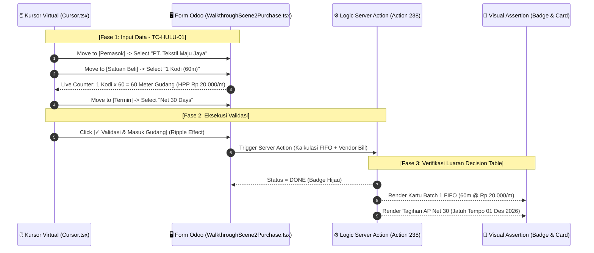

# 📋 DECISION TABLE TEST CASES (TAHAP 1: HULU)
## Pengadaan Bahan Baku, Konversi Satuan Grosir, Kartu FIFO, & Hutang AP Net 30

Dokumen ini disusun menggunakan metodologi **Senior QA Test Design Techniques (ISTQB Standard)** untuk memetakan seluruh kombinasi logika bisnis pada modul Hulu, sekaligus menjadi **skenario rujukan (*blueprint*) eksekusi skrip animasi/walkthrough Remotion**.

---

## 1. 📐 Matriks Tabel Keputusan (*Decision Table Matrix*)

### Kuadran Kondisi (*Condition Stub & Entries*) dan Aksi (*Action Stub & Entries*)

| Kode | Kondisi / Aksi (*Conditions & Actions*) | Rule 1 (R1) ⭐ *Golden Path* | Rule 2 (R2) *Roll + Net 30* | Rule 3 (R3) *Meter + Cash* | Rule 4 (R4) *Negative Zero Qty* | Rule 5 (R5) *No Payment Term* |
| :--- | :--- | :---: | :---: | :---: | :---: | :---: |
| **C1** | Data Master Barang Induk (*UoM: Meter*) Valid? | **Y** | **Y** | **Y** | **Y** | **Y** |
| **C2** | Jenis Satuan Beli Grosir (*UoM PO*) | **Kodi (60m)** | **Roll (100m)** | **Meter (1m)** | **Kodi (60m)** | **Kodi (60m)** |
| **C3** | Qty Beli & Harga Beli Valid ($> 0$)? | **Y** | **Y** | **Y** | **N (Qty = 0)** | **Y** |
| **C4** | Syarat Pembayaran (*Payment Term*) | **Net 30 Days** | **Net 30 Days** | **Immediate (Cash)** | **Net 30 Days** | **None (Kosong)** |
| **C5** | Tombol *[✓ Validasi / Confirm]* Diklik? | **Y** | **Y** | **Y** | **Y** | **Y** |
| | **--- KEPUTUSAN SISTEM / AKSI LUARAN ---** | | | | | |
| **A1** | Konversi Satuan ke Meter Gudang Presisi | **X** (60 Meter) | **X** (100 Meter) | **X** (1 Meter) | - | **X** (60 Meter) |
| **A2** | Hitung HPP Dasar Gudang ($\text{Subtotal} / \text{m}$) | **X** (Rp 20.000/m) | **X** (Rp 18.000/m) | **X** (Rp 25.000/m) | - | **X** (Rp 20.000/m) |
| **A3** | Terbitkan Record FIFO Batch Baru (`x_pos_batch`) | **X** (Batch 1) | **X** (Batch 2) | **X** (Batch 3) | - | **X** (Batch FIFO) |
| **A4** | Hitung Tanggal Jatuh Tempo ($\text{Tgl PO} + 30\text{ Hari}$) | **X** (01 Des 2026) | **X** (01 Des 2026) | - (Hari H) | - | - (Hari H Default) |
| **A5** | Terbitkan Faktur Hutang Vendor Bill AP (`account.move`) | **X** (Status: Not Paid) | **X** (Status: Not Paid) | **X** (Status: Paid) | - | **X** (Draft Bill) |
| **A6** | Status PO Berubah Menjadi `DONE` | **X** | **X** | **X** | - | **X** |
| **A7** | Tolak Validasi & Tampilkan *User Error Dialog* | - | - | - | **X** ("Qty Wajib > 0") | - |

---

## 2. 🧪 Penjabaran Test Case Terstruktur (Senior QA Specification)

### TC-HULU-01: Pembelian Restock Grosir 1 Kodi dengan Syarat Tempo Net 30 (R1 - Golden Path)
* **Kategori & Prioritas:** Positif / E2E Golden Path (**P1 - Critical**)
* **Tujuan Pengujian:** Memastikan pembelian 1 Kodi otomatis dikalikan 60 meter, HPP dasar terkunci di Rp 20.000/m, kartu FIFO Batch terbit sebagai prioritas potong tertua, dan tagihan AP jatuh tempo tepat 30 hari.
* **Pre-conditions:**
  * Master Barang `Kain Katun Sprei "XXX"` aktif dengan faktor konversi `1 Kodi = 60 Meter`.
  * Vendor `PT. Tekstil Maju Jaya` terdaftar.
  * Payment Term `Net 30 Days` aktif.
* **Langkah Uji & Data Input:**
  1. Buka formulir `x_pos_purchase`, klik tombol `+ Baru`.
  2. Input Pemasok: `PT. Tekstil Maju Jaya`.
  3. Input Tanggal PO: `01/11/2026`.
  4. Tambah Baris Pembelian:
     * Produk: `Kain Katun Sprei "XXX"`
     * Satuan Beli: `Kodi`
     * Qty Beli: `1`
     * Harga Satuan: `Rp 1.200.000`
  5. Pilih Termin Pembayaran: `Net 30 Days`.
  6. Klik tombol `[✓ Validasi & Masuk Gudang]`.
* **Ekspektasi Hasil Sistem:**
  * Status PO berubah menjadi **DONE**.
  * Terbentuk record pada `x_pos_batch` dengan qty: **60 Meter**, sisa: **60 Meter**, HPP: **Rp 20.000 / meter**.
  * Terbentuk record pada `account.move` (*Vendor Bill*) dengan nomor `BILL/2026/11/0001`, tanggal jatuh tempo `01/12/2026`, status `not_paid`.
* **🎬 Remotion Walkthrough Scene Mapping:**
  * Dimainkan pada **Scene 2 (Frames 450 – 930)**:
    - Kursor bergerak ke field Vendor $\rightarrow$ pilih PT Tekstil Maju Jaya.
    - Kursor memilih satuan Kodi $\rightarrow$ kalkulator angka konversi berjalan ke 60m.
    - Kursor memilih termin Net 30 $\rightarrow$ badge merah "Jatuh Tempo: 01 Des 2026".
    - Klik tombol hijau Validasi $\rightarrow$ Stamp "DONE" + pop-up kartu Batch 1 FIFO.

---

### TC-HULU-02: Pembelian Grosir Skala Besar 1 Roll (100 Meter) Tempo Net 30 (R2)
* **Kategori & Prioritas:** Positif / Skalabilitas Grosir (**P2 - High**)
* **Tujuan Pengujian:** Memverifikasi fleksibilitas sistem menerima satuan Roll (100m) dengan HPP berbeda dan antrean batch FIFO kedua yang terpisah.
* **Pre-conditions:** Batch 1 (TC-HULU-01) sudah ada di gudang.
* **Langkah Uji & Data Input:**
  * Input PO baru: 1 Roll seharga Rp 1.800.000, Termin: Net 30 Days.
* **Ekspektasi Hasil Sistem:**
  * Stok masuk: **100 Meter**, HPP: **Rp 18.000 / meter**.
  * Terbit `Batch 2 FIFO` dengan sequence nomor setelah Batch 1.
  * Saat pemotongan konveksi nanti, sistem wajib menghabiskan sisa Batch 1 dulu sebelum mengambil Batch 2.

---

### TC-HULU-03: Pembelian Eceran Satuan Meter Tunai Tanpa Hutang (R3)
* **Kategori & Prioritas:** Positif / Cash Purchase (**P2 - Medium**)
* **Tujuan Pengujian:** Memastikan jika pembelian dalam satuan meter langsung dan bayar tunai (Immediate), sistem tidak membuat saldo hutang tertunda.
* **Langkah Uji & Data Input:**
  * Qty: 20 Meter, Harga: Rp 500.000, Termin: Immediate Cash.
* **Ekspektasi Hasil Sistem:**
  * Terbit Batch FIFO 20 Meter @ Rp 25.000/m.
  * Vendor Bill langsung berstatus **Paid / In Payment**, memotong jurnal kas tunai.

---

### TC-HULU-04: Validasi Error Saat Qty Beli Bernilai Nol atau Negatif (R4 - Boundary Negative)
* **Kategori & Prioritas:** Negatif / Validasi Input Form (**P1 - Critical**)
* **Tujuan Pengujian:** Mencegah staf gudang atau pengguna salah input angka 0 yang dapat merusak pembagi HPP ($\text{DivByZeroError}$).
* **Langkah Uji & Data Input:**
  * Masukkan Qty Beli: `0` atau `-5`. Klik `Validasi`.
* **Ekspektasi Hasil Sistem:**
  * Sistem memblokir eksekusi (*raise ValidationError*).
  * Pesan pop-up: *"Jumlah pembelian harus lebih besar dari 0 meter!"*. Status tetap **Draft**.

---

### TC-HULU-05: Penanganan Default Termin Kosong / Missing Terms (R5 - Robustness)
* **Kategori & Prioritas:** Edge Case / Penanganan Nilai Null (**P3 - Low**)
* **Tujuan Pengujian:** Memastikan jika pengguna lupa memilih termin, sistem otomatis menetapkan tanggal jatuh tempo sama dengan tanggal pembelian (Cash On Delivery).
* **Ekspektasi Hasil Sistem:**
  * `x_due_date` default ke `x_purchase_date`. Tidak menyebabkan *crash* pada Server Action Odoo.

---

## 3. 🎬 Rencana Eksekusi Skrip Remotion (Walkthrough Automation Plan)

Hasil Decision Table di atas diterjemahkan ke dalam parameter animasi komponen Remotion (`invo_video`):

### Timeline & Frame Budgeting Remotion untuk Tahap Hulu:
* **Frame 0 – 75:** Kursor memilih Pemasok `PT. Tekstil Maju Jaya` + ripple click.
* **Frame 75 – 170:** Kursor memilih satuan beli `1 Kodi` $\rightarrow$ kalkulator konversi meter berjalan dari 0 ke 60.
* **Frame 170 – 265:** Kursor memilih termin `Net 30 Days` $\rightarrow$ badge tanggal jatuh tempo `01 Des 2026` aktif.
* **Frame 265 – 350:** Kursor meluncur ke tombol hijau `[✓ Validasi]` $\rightarrow$ klik tombol (button down state + ripple wave).
* **Frame 350 – 480:** Transisi status ke **DONE** dan animasi dua kartu luaran:
  1. Kartu biru persediaan **Batch 1 FIFO** (60m @ Rp 20rb).
  2. Kartu merah faktur **Vendor Bill AP** (Net 30, Jatuh tempo 01 Des 2026).
