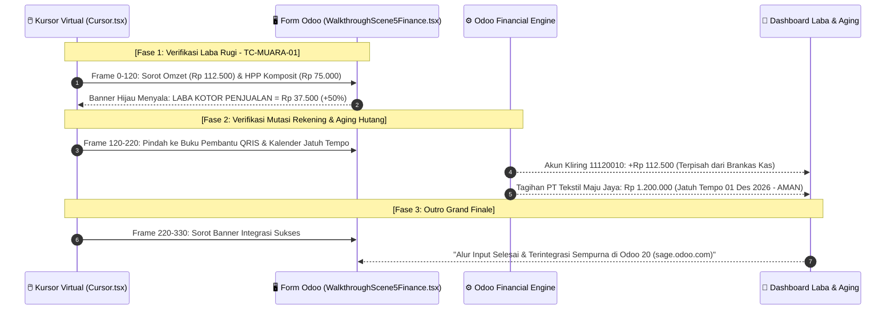

# 📋 DECISION TABLE TEST CASES (TAHAP 4: MUARA AKHIR)
## Laporan Finansial Real-Time, Laba Bersih & Kontrol Likuiditas Aging Hutang AP

Dokumen ini disusun menggunakan metodologi **Senior QA Test Design Techniques (ISTQB Standard)** untuk memetakan logika pelaporan laba rugi real-time, pencatatan mutasi rekening terpisah, dan kontrol tanggal jatuh tempo tagihan hutang supplier 30 hari (*Aged Payables*).

---

## 1. 📐 Matriks Tabel Keputusan (*Decision Table Matrix*)

### Kuadran Kondisi (*Condition Stub & Entries*) dan Aksi (*Action Stub & Entries*)

| Kode | Kondisi / Aksi (*Conditions & Actions*) | Rule 1 (R1) ⭐ *Golden Path* | Rule 2 (R2) *Due in 7 Days* | Rule 3 (R3) *Overdue (>30 Hari)* | Rule 4 (R4) *Bill Paid / Lunas* | Rule 5 (R5) *Zero Sales Period* |
| :--- | :--- | :---: | :---: | :---: | :---: | :---: |
| **C1** | Ada Penjualan Kasir Valid Terhadap Sprei XL? | **Y (1 pcs)** | **Y (1 pcs)** | **Y (1 pcs)** | **Y (1 pcs)** | **N (0 pcs)** |
| **C2** | HPP Komposit Terkunci Terhubung ke Penjualan? | **Y (Rp 75.000)** | **Y (Rp 75.000)** | **Y (Rp 75.000)** | **Y (Rp 75.000)** | - |
| **C3** | Posisi Tanggal Terhadap Jatuh Tempo Vendor Bill | **Aman (0-30 Hari)** | **Mendekati (<= 7 Hari)** | **Lewat (> 30 Hari)** | **Aman / Bebas** | **Aman** |
| **C4** | Status Faktur Tagihan Vendor Bill | **Not Paid** | **Not Paid** | **Not Paid** | **Paid (Lunas)** | **Not Paid** |
| | **--- KEPUTUSAN SISTEM / AKSI LUARAN ---** | | | | | |
| **A1** | Akui Pendapatan Penjualan Kasir (*Revenue*) | **X** (Rp 112.500) | **X** (Rp 112.500) | **X** (Rp 112.500) | **X** (Rp 112.500) | - (Rp 0) |
| **A2** | Bebankan HPP Komposit Penjualan (*COGS*) | **X** (Rp 75.000) | **X** (Rp 75.000) | **X** (Rp 75.000) | **X** (Rp 75.000) | - (Rp 0) |
| **A3** | Tampilkan Laba Kotor Penjualan (*Gross Profit*) | **X** (Rp 37.500) | **X** (Rp 37.500) | **X** (Rp 37.500) | **X** (Rp 37.500) | - (Rp 0) |
| **A4** | Catat Saldo Terpisah di Akun Kliring 11120010 | **X** (+Rp 112.500) | **X** (+Rp 112.500) | **X** (+Rp 112.500) | **X** (+Rp 112.500) | - |
| **A5** | Tampilkan Status Hutang "Aman (01 Des 2026)" | **X** | - | - | - | **X** |
| **A6** | Tampilkan Peringatan Kuning (*Due Soon*) | - | **X** | - | - | - |
| **A7** | Tampilkan Peringatan Merah (*Overdue Alert*) | - | - | **X** | - | - |
| **A8** | Saldo Hutang Vendor Tertutup Menjadi Nol | - | - | - | **X** | - |

---

## 2. 🧪 Penjabaran Test Case Terstruktur (Senior QA Specification)

### TC-MUARA-01: Laporan Laba Bersih Penjualan & Pengingat Hutang Aman (R1 - Golden Path)
* **Kategori & Prioritas:** Positif / E2E Golden Path (**P1 - Critical**)
* **Tujuan Pengujian:** Memastikan seluruh rangkaian hulu-ke-hilir bermuara pada laporan laba rugi instan: Omzet Rp 112.500 dikurangi HPP Rp 75.000 menghasilkan Laba Kotor Rp 37.500 (+50%), mutasi dana tercatat pada akun kliring QRIS 11120010, dan tagihan PT Tekstil Maju Jaya terpantau aman jatuh tempo 1 Desember 2026.
* **Pre-conditions:**
  * Telah terjadi penjualan 1 pcs Sprei XL via POS (TC-HILIR-01).
  * Tagihan Vendor Bill PO-202611-0001 (TC-HULU-01) berstatus `not_paid` dengan jatuh tempo `01/12/2026`.
* **Langkah Uji & Data Input:**
  1. Buka menu `📊 Akuntansi & Laporan`.
  2. Buka Laporan Laba Rugi (*Profit & Loss*).
  3. Buka Buku Pembantu Bank & QRIS (*General Ledger 11120010*).
  4. Buka Widget Pengingat Jatuh Tempo Hutang (*Aged Payables*).
* **Ekspektasi Hasil Sistem:**
  * Kolom Penjualan Kasir: **Rp 112.500**.
  * Kolom HPP Komposit: **(Rp 75.000)**.
  * Laba Kotor Penjualan: **Rp 37.500** (+50% margin).
  * Mutasi Masuk Akun Kliring `11120010`: **+Rp 112.500**.
  * Status Tagihan PT Tekstil Maju Jaya (Rp 1.200.000): Terjadwal jatuh tempo **01 Desember 2026** (Status: Aman / Hijau).
* **🎬 Remotion Walkthrough Scene Mapping:**
  * Dimainkan pada **Scene 5 (Frames 1920 – 2250)**:
    - Kursor memeriksa kartu omzet Rp 112.500 & HPP Rp 75.000.
    - Banner Laba Bersih Rp 37.500 bercahaya hijau.
    - Kursor memeriksa mutasi akun QRIS +Rp 112.500 dan widget jatuh tempo hutang 01 Des 2026.
    - Banner penutup sukses: "Alur Input Selesai & Terintegrasi Sempurna di Odoo 20!".

---

### TC-MUARA-02: Peringatan Dini 7 Hari Sebelum Jatuh Tempo (R2 - Early Warning System)
* **Kategori & Prioritas:** Positif / Cash Flow Management (**P2 - High**)
* **Tujuan Pengujian:** Memastikan sistem memicu indikator peringatan kuning saat tanggal saat ini memasuki rentang $\le 7\text{ Hari}$ sebelum jatuh tempo agar manajemen mempersiapkan dana pelunasan.
* **Skenario Data Input:**
  * Tanggal transaksi simulasi: `25 November 2026` (6 hari sebelum 1 Desember 2026).
* **Ekspektasi Hasil Sistem:**
  * Widget Aging menampilkan badge kuning *"Segera Jatuh Tempo dalam 6 Hari"*.

---

### TC-MUARA-03: Peringatan Kritis Keterlambatan Bayar Hutang Supplier (R3 - Overdue Alert)
* **Kategori & Prioritas:** Negatif / AP Delinquency Guard (**P1 - Critical**)
* **Tujuan Pengujian:** Memverifikasi jika tagihan belum dibayar saat melewati tanggal 1 Desember 2026, sistem menampilkan badge merah tanda bahaya agar tidak merusak reputasi toko di mata supplier kain.
* **Skenario Data Input:**
  * Tanggal transaksi simulasi: `05 Desember 2026` (Lewat 4 hari dari due date), status: `not_paid`.
* **Ekspektasi Hasil Sistem:**
  * Muncul badge merah menyala: *"OVERDUE (Terlambat 4 Hari)"*.
  * Alert otomatis pada dashboard akuntansi toko.

---

### TC-MUARA-04: Pelunasan Tagihan Hutang Supplier (R4 - Bill Settlement)
* **Kategori & Prioritas:** Positif / AP Clearance (**P2 - High**)
* **Tujuan Pengujian:** Memvalidasi saat pembayaran hutang dieksekusi via transfer bank, saldo hutang terhapus dan saldo rekening bisnis bank berkurang sesuai nilai pelunasan.
* **Langkah Uji & Data Input:**
  * Buka Vendor Bill `BILL/2026/11/0001` (Rp 1.200.000). Klik `Register Payment`, pilih Jurnal `[BNK1] Rekening Bisnis Bank`.
* **Ekspektasi Hasil Sistem:**
  * Status Vendor Bill berubah menjadi **PAID**.
  * Saldo hutang dagang supplier menjadi **Rp 0**.
  * Buku bank `[BNK1]` berkurang **-Rp 1.200.000**.

---

### TC-MUARA-05: Neraca Saldo Saat Belum Ada Penjualan (R5 - Idle Inventory Valuation)
* **Kategori & Prioritas:** Positif / Baseline Financials (**P3 - Low**)
* **Tujuan Pengujian:** Memastikan jika produk sudah dijahit dan masuk rak tapi belum ada penjualan, nilai HPP tidak diakui sebagai biaya laba rugi, melainkan tetap tersimpan sebagai Nilai Aset Persediaan (*Inventory Asset*) di Neraca Toko.
* **Ekspektasi Hasil Sistem:**
  * Laba Rugi = Rp 0.
  * Neraca (*Balance Sheet*): Nilai Persediaan Sprei XL = 10 pcs x Rp 75.000 = Rp 750.000 (Aset Lancar).

---

## 3. 🎬 Rencana Eksekusi Skrip Remotion (Scene 5 Walkthrough Automation)

Matriks **Rule 1 (R1 - Golden Path)** dieksekusi secara visual pada komponen `WalkthroughScene5Finance.tsx` (`invo_video`):

