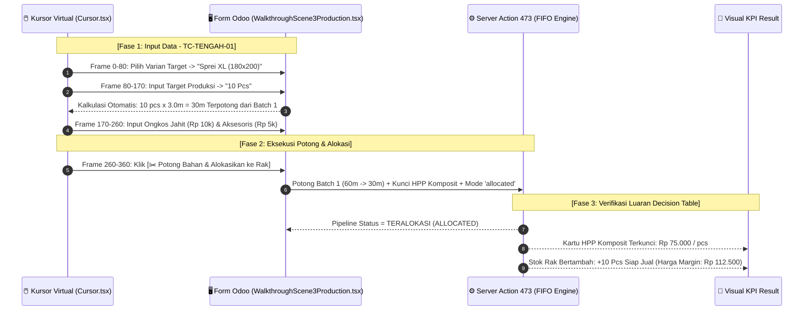

# 📋 DECISION TABLE TEST CASES (TAHAP 2: TENGAH)
## Konveksi Make-to-Stock, Potong Kain FIFO, Ongkos Jahit, & Alokasi Kuota Rak Toko

Dokumen ini disusun menggunakan metodologi **Senior QA Test Design Techniques (ISTQB Standard)** untuk memetakan seluruh kombinasi logika bisnis pada proses produksi konveksi, konsumsi bahan baku FIFO, kalkulasi HPP komposit, dan alokasi stok rak kasir.

---

## 1. 📐 Matriks Tabel Keputusan (*Decision Table Matrix*)

### Kuadran Kondisi (*Condition Stub & Entries*) dan Aksi (*Action Stub & Entries*)

| Kode | Kondisi / Aksi (*Conditions & Actions*) | Rule 1 (R1) ⭐ *Golden Path* | Rule 2 (R2) *Split Multi-Batch* | Rule 3 (R3) *Zero Labor/Acc* | Rule 4 (R4) *Stok Kain Kurang* | Rule 5 (R5) *Invalid Qty (<=0)* |
| :--- | :--- | :---: | :---: | :---: | :---: | :---: |
| **C1** | Varian Target Terpilih & Valid (*Sprei XL*)? | **Y** | **Y** | **Y** | **Y** | **Y** |
| **C2** | Ketersediaan Stok Kain FIFO Gudang | **Cukup (1 Batch)** | **Cukup (Pecah 2 Batch)** | **Cukup (1 Batch)** | **Kurang (Defisit)** | **Cukup** |
| **C3** | Komponen Biaya Upah Jahit & Aksesoris | **Lengkap (> 0)** | **Lengkap (> 0)** | **Nol (Rp 0)** | **Lengkap (> 0)** | **Lengkap (> 0)** |
| **C4** | Target Qty Produksi Valid ($> 0$)? | **Y (10 pcs)** | **Y (20 pcs)** | **Y (5 pcs)** | **Y (50 pcs)** | **N (0 / -1)** |
| **C5** | Tombol *[✂️ Potong Bahan & Alokasikan]* Diklik? | **Y** | **Y** | **Y** | **Y** | **Y** |
| | **--- KEPUTUSAN SISTEM / AKSI LUARAN ---** | | | | | |
| **A1** | Potong Meteran Kain dari Batch 1 Tertua | **X** (30 Meter) | **X** (Habiskan Batch 1) | **X** (15 Meter) | - | - |
| **A2** | Lanjut Potong ke Batch 2 FIFO Berikutnya | - | **X** (Sisa dari Batch 2) | - | - | - |
| **A3** | Akumulasi Biaya HPP Komposit per Pcs | **X** (Rp 75.000/pcs) | **X** (Blended Cost) | **X** (HPP Murni Kain) | - | - |
| **A4** | Ubah Mode Stok Varian Menjadi `'allocated'` | **X** | **X** | **X** | - | - |
| **A5** | Tambah Kuota Fisik Rak Siap Jual Kasir | **X** (+10 Pcs) | **X** (+20 Pcs) | **X** (+5 Pcs) | - | - |
| **A6** | Update Harga Jual Kasir Margin +50% | **X** (Rp 112.500) | **X** (Margin Target) | **X** (Margin Target) | - | - |
| **A7** | Status Produksi Berubah Menjadi `DONE` | **X** | **X** | **X** | - | - |
| **A8** | Blokir & Tampilkan Error Alert Odoo | - | - | - | **X** ("Stok Kurang!") | **X** ("Qty > 0!") |

---

## 2. 🧪 Penjabaran Test Case Terstruktur (Senior QA Specification)

### TC-TENGAH-01: Produksi Make-to-Stock 10 Pcs Sprei XL dengan Biaya Jahit & Kemasan (R1 - Golden Path)
* **Kategori & Prioritas:** Positif / E2E Golden Path (**P1 - Critical**)
* **Tujuan Pengujian:** Memastikan pemotongan kain 30 meter berhasil memotong Batch 1 FIFO tertua, biaya bahan + upah + kemasan terkunci menjadi HPP komposit Rp 75.000/pcs, dan rak kasir bertambah 10 pcs siap jual dengan harga Rp 112.500.
* **Pre-conditions:**
  * Batch 1 FIFO memiliki sisa $\ge 30\text{ Meter}$ pada HPP Rp 20.000/m.
  * Varian `Sprei XL (180x200)` memiliki kebutuhan 3.0 m/pcs dan margin harga 50%.
* **Langkah Uji & Data Input:**
  1. Buka menu `✂️ Produksi Jahit`, klik `+ Baru`.
  2. Pilih Produk Induk: `Kain Katun Sprei "XXX"`.
  3. Pilih Varian Target: `Sprei XL (180 × 200)`.
  4. Masukkan Jumlah Produksi: `10` Pcs (Sistem menghitung $10 \times 3.0\text{m} = \mathbf{30\text{ Meter}}$).
  5. Masukkan Biaya Tambahan:
     * Ongkos Jahit Borongan: `Rp 10.000` per pcs (Subtotal: Rp 100.000).
     * Aksesoris & Tas Kemasan: `Rp 5.000` per pcs (Subtotal: Rp 50.000).
  6. Klik tombol `[✂️ Potong Bahan & Alokasikan ke Rak]`.
* **Ekspektasi Hasil Sistem:**
  * Sisa kuota meter pada `Batch 1 FIFO` berkurang sebesar 30 meter (dari 60m menjadi 30m).
  * Terhitung Total Biaya Produksi: $\text{Rp } 600.000 + 100.000 + 50.000 = \mathbf{\text{Rp } 750.000}$.
  * HPP Komposit per Pcs terkunci pada nilai: $\frac{\text{Rp } 750.000}{10} = \mathbf{\text{Rp } 75.000/\text{pcs}}$.
  * Varian Sprei XL berubah mode ke `x_studio_mode_stok = 'allocated'`.
  * Stok fisik di rak kasir bertambah **+10 Pcs**.
  * Harga jual di kasir terhitung: $\text{Rp } 75.000 \times 1.5 = \mathbf{\text{Rp } 112.500}$.
  * Status formulir produksi berubah menjadi **DONE**.
* **🎬 Remotion Walkthrough Scene Mapping:**
  * Dimainkan pada **Scene 3 (Frames 930 – 1440)**:
    - Kursor memilih varian target Sprei XL.
    - Kursor mengisi target Qty: 10 pcs $\rightarrow$ animasi kalkulasi kebutuhan 30m.
    - Kursor mengisi ongkos jahit Rp 10k & aksesoris Rp 5k.
    - Kursor mengklik tombol `[✂️ Potong Bahan & Alokasikan]` $\rightarrow$ status DONE.
    - Kartu ringkasan menampilkan HPP Rp 75.000 terkunci & stok rak bertambah +10 pcs.

---

### TC-TENGAH-02: Pemotongan Bahan Baku FIFO Lintas Dua Batch / Multi-Batch Split (R2)
* **Kategori & Prioritas:** Positif / FIFO Exhaustion (**P2 - High**)
* **Tujuan Pengujian:** Memverifikasi jika kebutuhan potong melebihi sisa Batch 1, sistem otomatis menghabiskan Batch 1 sampai nol dan mengambil sisa kekurangannya dari Batch 2 (*FIFO auto-chain*).
* **Skenario Data Input:**
  * Batch 1 tersisa 10 Meter (@ Rp 20.000).
  * Batch 2 tersedia 100 Meter (@ Rp 18.000).
  * Target Produksi: 10 Pcs Sprei XL (Kebutuhan: 30 Meter).
* **Ekspektasi Hasil Sistem:**
  * Batch 1 terpotong 10 Meter $\rightarrow$ Sisa **0 Meter** (Status: Inactive).
  * Batch 2 terpotong 20 Meter $\rightarrow$ Sisa **80 Meter**.
  * Total Biaya Kain: $(10\text{m} \times 20.000) + (20\text{m} \times 18.000) = 200.000 + 360.000 = \mathbf{\text{Rp } 560.000}$.
  * HPP Komposit menyesuaikan secara proporsional presisi.

---

### TC-TENGAH-03: Produksi Internal Tanpa Biaya Jahit Tambahan (R3 - Zero Labor)
* **Kategori & Prioritas:** Positif / Baseline Costing (**P2 - Medium**)
* **Tujuan Pengujian:** Menjamin jika konveksi dikerjakan karyawan bergaji tetap (tanpa biaya borongan satuan), sistem tetap menghitung HPP murni dari bahan baku kain tanpa memicu pembagian nol.
* **Langkah Uji & Data Input:**
  * Upah Jahit: `Rp 0`, Aksesoris: `Rp 0`, Target Qty: 5 Pcs (15 Meter).
* **Ekspektasi Hasil Sistem:**
  * HPP Satuan = HPP Kain Murni ($\text{Rp } 20.000 \times 3.0\text{m} = \mathbf{\text{Rp } 60.000/\text{pcs}}$).

---

### TC-TENGAH-04: Penolakan Validasi Saat Stok Kain Gudang Tidak Mencukupi (R4 - Stock Deficit Negative)
* **Kategori & Prioritas:** Negatif / Stock Integrity Guard (**P1 - Critical**)
* **Tujuan Pengujian:** Mencegah produksi berjalan jika seluruh antrean Batch FIFO aktif tidak mencukupi kebutuhan meter total, menjaga stok tidak menjadi minus (*no negative inventory*).
* **Skenario Data Input:**
  * Total stok kain di seluruh batch: 15 Meter.
  * Target Produksi: 10 Pcs Sprei XL (Kebutuhan: 30 Meter).
  * Klik tombol `[✂️ Potong Bahan & Alokasikan]`.
* **Ekspektasi Hasil Sistem:**
  * Sistem memunculkan dialog peringatan: *"Stok kain gudang (15m) tidak mencukupi untuk memotong 30m!"*.
  * Status transaksi tetap **Draft**, tidak ada stok yang terpotong.

---

### TC-TENGAH-05: Penolakan Validasi Saat Target Qty Nol atau Negatif (R5 - Boundary Negative)
* **Kategori & Prioritas:** Negatif / Form Validation (**P2 - High**)
* **Tujuan Pengujian:** Mencegah kesalahan input jumlah 0 atau angka minus yang merusak kalkulator HPP satuan.
* **Ekspektasi Hasil Sistem:**
  * Muncul pesan error validasi: *"Jumlah target produksi wajib lebih besar dari 0 pcs!"*.

---

## 3. 🎬 Rencana Eksekusi Skrip Remotion (Scene 3 Walkthrough Automation)

Matriks **Rule 1 (R1 - Golden Path)** dieksekusi secara visual pada komponen `WalkthroughScene3Production.tsx` (`invo_video`):

