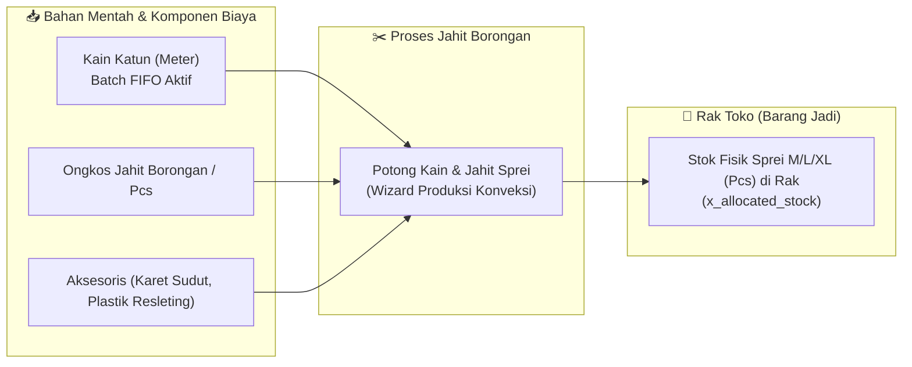
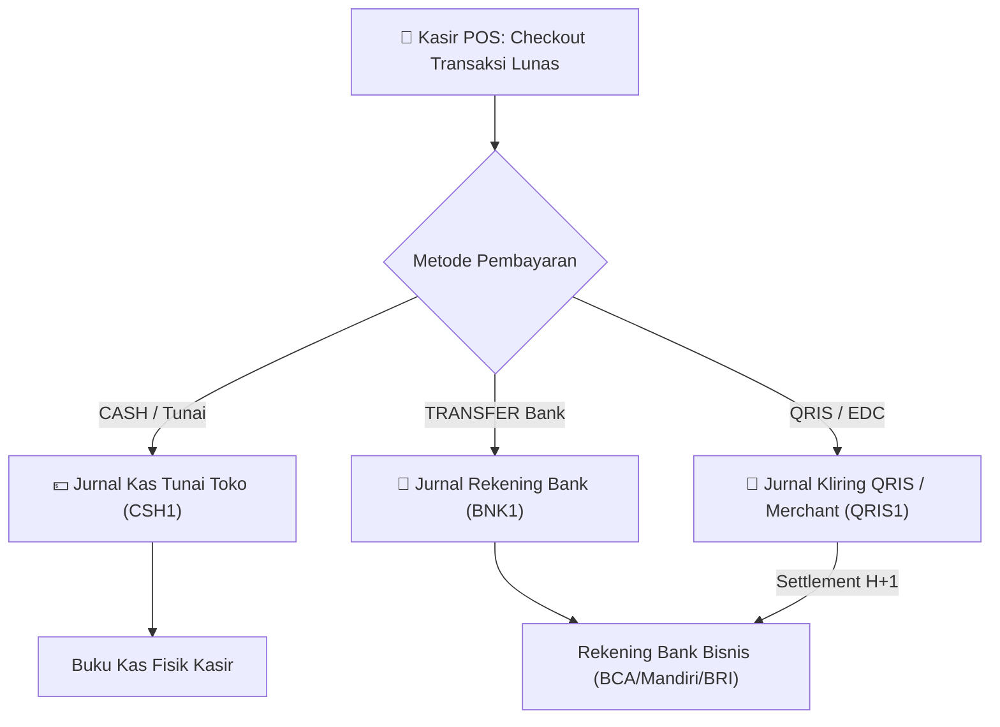
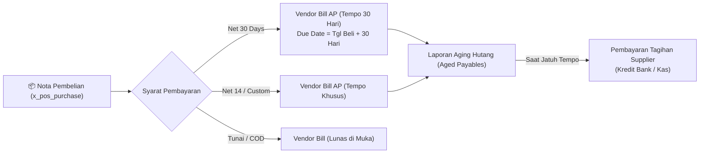
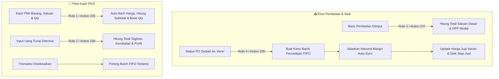

# 📄 PRODUCT REQUIREMENTS DOCUMENT (PRD)
# Sistem POS & Manajemen Inventori Multi-Role

---

## 📌 Dokumen Meta & Version Control

| Atribut | Detail |
| :--- | :--- |
| **Nama Proyek** | Multi-Role POS & Inventory System with FIFO, Multi-Unit Conversion & Odoo Enterprise Architecture |
| **Status Dokumen** | **APPROVED & LIVE IN ODOO ENTERPRISE (SAGE)** |
| **Versi Terkini** | **v2.2.0** |
| **Tanggal Rilis Terkini** | 11 November 2026 |
| **Arsitektur** | Dual-Stack Architecture (Invo. Node.js/Knex Engine & Odoo 20.0+e Studio Enterprise Cloud Integration) |
| **Stack Teknologi** | • Core Engine: Node.js, Express.js, Knex.js, SQLite (better-sqlite3), Vanilla JS SPA, Modern Invo CSS3 Theme<br>• ERP Cloud: Odoo 20.0 Enterprise SaaS (`sage.odoo.com`), Odoo Studio ORM, Python Server Automations (`base.automation`), XML-RPC / JSON-RPC External API, Odoo MCP AI Tools |

---

## 📜 Riwayat Versi (Change Tracking & Changelog)

| Versi | Tanggal | Status | Ringkasan Perubahan |
| :---: | :---: | :---: | :--- |
| **v1.0.0** | 26 Sep 2026 | *Baseline* | Rilis inisial SDD: 9 tabel, stok FIFO satuan dasar, kasir & reseller POS, laporan laba rugi. |
| **v1.1.0** | 27 Sep 2026 | *Superseded* | Upgrade Master Item & Multi-Unit Variant (tabel `items`, single-setup multi-satuan, autocomplete pembelian, direct qty di POS). |
| **v1.2.0** | 27 Sep 2026 | *Superseded* | Data Migration & Backdate POS: Input tanggal backdate di POS Kasir, normalisasi boundary tanggal laporan, reset bersih baris varian, sinkronisasi dinamis label kebutuhan stok. |
| **v1.3.0** | 28 Sep 2026 | *Superseded* | Otomatisasi Harga Jual Berbasis Margin pada Pembelian (Inbound Margin Sync) dengan jaminan integritas data transaksi penjualan historis tidak terpengaruh (frozen snapshot). |
| **v1.4.0** | 28 Sep 2026 | *Superseded* | Role Khusus "Developer" & Modul Pembersihan Data Terfilter: Penambahan peran Developer dengan tampilan antarmuka terisolasi (hanya 1 menu khusus), formulir penghapusan fleksibel (wipe all data atau seleksi form/modul tertentu dengan rentang tanggal), proteksi akun sistem, serta kontrol akses ketat (RBAC). |
| **v1.5.0** | 28 Sep 2026 | *Superseded* | Peremajaan Antarmuka Menyeluruh (Invo. Modern SaaS UI Theme Overhaul) & Visual User Guide: Transformasi desain visual mengikuti tema Invo. dengan Electric Blue (`#1a62ff`), window wrapper macOS 3-dots, logo 3D, navigasi kapsul pil menyala, 4 stat cards pastel, grafik batang vertikal pendapatan, dan kartu aksi promosi. |
| **v2.2.0** | 11 Nov 2026 | **Current** | 🟢 **Konveksi Make-to-Stock (Jahit Borongan Sprei), Multi-Jurnal Kasir & Hutang Pembelian Supplier (Net 30):**<br>1. **Konveksi Make-to-Stock & HPP Komposit:** Penambahan arsitektur produksi sprei borongan sebelum dipajang di rak toko. HPP modal sprei jadi mengunci formula komposit: (Kebutuhan Kain × HPP FIFO Kain Aktif) + Ongkos Jahit Borongan + Biaya Aksesoris (Karet sudut, plastik kemasan). Pemotongan otomatis stok meteran kain dari batch FIFO dan penambahan stok fisik jadi ke rak toko (`x_allocated_stock`).<br>2. **Multi-Metode Pembayaran Kasir (Multi-Journal POS):** Integrasi pembayaran kasir ke multi-jurnal akuntansi: Kas Tunai Toko (`CSH1`), Rekening Bank Bisnis (`BNK1`), dan Kliring QRIS/EDC (`QRIS1` / Settlement H+1).<br>3. **Manajemen Hutang Supplier & Termin Tempo (Net 30):** Nota pembelian bahan baku mendukung syarat pembayaran tempo fleksibel (Net 30, Net 14, COD), kalkulasi tanggal jatuh tempo otomatis, serta laporan aging hutang dagang (*Aged Payables*).<br>4. **Integrasi Modul Akuntansi Odoo (`account`):** Pengaktifan modul akuntansi formal untuk penjurnalan otomatis transaksi kasir, pencatatan vendor bills pembelian, dan laporan laba rugi standar PSAK. |
| **v2.1.0** | 10 Nov 2026 | *Superseded* | 🟢 **Isolasi Batch Aktif FIFO Murni, Deduplikasi Dropdown Kasir & Modul Reset Terintegrasi:**<br>1. **Isolasi Batch Aktif FIFO Murni (Opsi A):** Mengganti kalkulasi *weighted average* pada saat nota pembelian baru masuk (misal `jkolo`). Sistem secara ketat mengisolasi batch tertua yang masih memiliki sisa kuantitas (`x_remaining_quantity > 0`). Nota pembelian baru diantrikan (*queued*) sebagai batch inaktif sampai batch tertua habis 100%. Varian harga dan kuota stok pada dropdown kasir murni merefleksikan batch aktif tertua tanpa menampilkan label nomor PO.<br>2. **Penyediaan Menu Khusus Reset & Sample Flow:** Penambahan Server Action 239 dan Menu 141 (`🛠️ Reset & Muat Sample Flow`, Sequence 99) di Odoo untuk mereset seluruh data kotor dan secara instan menyemai 1 alur sampel lengkap hulu-ke-hilir yang teruji.<br>3. **Penyelesaian Masalah Dropdown Duplikat & Eliminasi Varian Orphan:** Mengatasi duplikasi pilihan varian di kasir POS dengan membersihkan 18 record *orphan* (`x_master_barang_id = False`) akibat perilaku default Many2one Studio (`ondelete='set null'`), memperkuat domain filter permanen pada field `x_unit_id` (Field 8514) dan View 654 (`[('x_master_barang_id', '!=', False), ('x_studio_is_purchased', '=', True), ('x_studio_stok_siap_jual', '>', 0)]`), serta menyempurnakan script reset untuk cascading unlink.<br>4. **Sinkronisasi Reaktif POS Kasir Real-Time:** Penambahan `@api.depends` pada field unit price, subtotal, total penjualan, kembalian tunai, dan bahan terpotong untuk responsivitas seketika di web client tanpa perlu simpan manual. |
| **v2.0.0** | 10 Nov 2026 | *Superseded* | 🟢 **Implementasi Penuh Odoo 20.0 Enterprise Studio & Automasi Bisnis Terpadu:** Pemetaan dan replikasi lengkap seluruh flow bisnis ke dalam Odoo 20.0+e (Cloud SaaS `sage.odoo.com`). Implementasi model custom Studio (`x_master_barang`, `x_pos_supplier`, `x_pos_purchase`, `x_pos_batch`, `x_pos_order`, `x_pos_expense`), integrasi otomatisasi Python (`base.automation` + `ir.actions.server`) untuk kasir POS otomatis (auto-fetch harga satuan, auto-subtotal, kalkulasi kembalian tunai instan), otomatisasi konversi stok grosir ke satuan dasar, pembentukan batch FIFO otomatis saat nota pembelian berstatus Selesai (`done`), sinkronisasi harga jual margin (*Inbound Margin Auto-Sync*) dengan jaminan *historical freeze*, pencatatan beban operasional, pelaporan laba bersih, serta ekspos API eksternal (XML-RPC, JSON-RPC, Webhook, dan MCP). |

---

## 🏷️ Legenda Penanda Perubahan (Change Highlighting Legend)

* 🟢 `<span class="badge-add">[TAMBAH v2.2]</span>` : Fitur dan automasi baru pada v2.2.0 (Make-to-Stock Konveksi, Multi-Journal Kasir, & Hutang Supplier).
* 🟡 `<span class="badge-mod">[UBAH v2.2]</span>` : Integrasi modul akuntansi Odoo (account), syarat pembayaran bertempo, dan HPP komposit.
* 🟢 `<span class="badge-add">[TAMBAH v2.1]</span>` : Fitur, automasi, dan arsitektur baru pada v2.1.0 (Isolasi FIFO Murni, Menu Reset Sample, & Deduplikasi Kasir).
* 🟡 `<span class="badge-mod">[UBAH v2.1]</span>` : Modifikasi domain filter kasir, eliminasi orphan variant, dan promosi batch sekuensial.
* 🟢 `<span class="badge-add">[TAMBAH v2.0]</span>` : Fitur, automasi, dan arsitektur baru pada v2.0.0 (Odoo Enterprise Studio Implementation).
* 🟡 `<span class="badge-mod">[UBAH v2.0]</span>` : Modifikasi alur operasional kasir, sinkronisasi margin, dan ekspos API pada v2.0.0.
* 🟢 `<span class="badge-add">[TAMBAH v1.5]</span>` : Fitur, komponen UI, atau token desain pada v1.5.0 (Invo. Design System).
* 🟢 `<span class="badge-add">[TAMBAH v1.4]</span>` : Fitur yang ditambahkan pada rilis v1.4.0 (Role Developer & Cleanup Panel).
* 🟢 `<span class="badge-add">[TAMBAH v1.3]</span>` : Fitur yang ditambahkan pada rilis v1.3.0 (Inbound Margin Auto-Sync).
* 🟢 `<span class="badge-add">[TAMBAH v1.2]</span>` : Fitur yang ditambahkan pada rilis v1.2.0 (Backdate POS & Reset Form).
* 🟢 `<span class="badge-add">[TAMBAH v1.1]</span>` : Fitur yang ditambahkan pada rilis v1.1.0 (Master Item & Multi-Unit).
* 🔴 `<span class="badge-del">[HAPUS / DEPRECATED]</span>` : Alur lama yang dihapus/ditinggalkan demi integritas data & efisiensi.

---

## 1. EXECUTIVE SUMMARY & BUSINESS CONTEXT

Sistem Point of Sale (POS) dan manajemen inventori konveksi/tekstil/eceran/sembako yang mendukung multi-role (*Owner*, *Kasir*, *Reseller*, *Developer*) dengan kemampuan:
1. **Konversi Satuan Bertingkat (Bulk-to-Retail):** Inbound dalam satuan besar grosir (Roll, Kodi, Bal, Krat, Dus) yang dikonversi ke **Satuan Dasar** penyimpanan stok (Meter, Yard, Pcs, Kg).
2. **Pelacakan Stok FIFO Berbasis Satuan Dasar:** Pengeluaran stok memotong batch tertua (*First In, First Out*) untuk memastikan HPP akurat dan mencegah distorsi valuasi.
3. **Hierarki Master Item & Varian Satuan Jual:** Satu barang induk master dapat memiliki banyak satuan pecahan eceran (contoh: Barang `XXX` dipecah menjadi `Sprei M`, `Sprei L`, `Sprei XL`; atau Barang `Telur` dipecah menjadi `1/4 Kg`, `1/2 Kg`, `1 Kg`) yang dikonfigurasi dalam **satu kali setup (*single flow*)**.
4. 🟢 `[TAMBAH v1.2]` **Kesiapan Migrasi Data Historis (Backdate Transaction):** Memfasilitasi proses *go-live* dan migrasi data transaksi lampau toko melalui input tanggal transaksi (*backdate*) di POS Kasir maupun Pembelian dengan akurasi pencatatan laporan keuangan sesuai tanggal historis.
5. 🟢 `[TAMBAH v1.3 / v2.0]` **Otomatisasi Penetapan Harga Jual Berbasis Margin (% Margin Sync):** Ketika barang di-setup dengan metode persentase profit sebelum ada riwayat pembelian (harga jual awal Rp 0), pencatatan restock pembelian perdana maupun selanjutnya otomatis menghitung HPP tertimbang dan memperbarui harga jual di master varian produk, tanpa mengubah sedikit pun nota transaksi penjualan lampau (*Historical Freeze Guarantee*).
6. 🟢 `[TAMBAH v1.4]` **Manajemen Pemeliharaan & Reset Data Khusus (Role Developer):** Menyediakan akun khusus peran *Developer* yang terisolasi hanya dapat mengakses menu *Maintenance*, untuk membersihkan data uji coba atau menghapus data spesifik per form/modul dalam rentang tanggal tertentu secara aman.
7. 🟢 `[TAMBAH v2.0]` **Kasir POS Otomatis & Cepat (Zero-Hassle Cashier Flow):** Kasir hanya perlu menginput Barang Induk, Satuan Jual, dan Kuantitas (Qty). Sistem otomatis mengisi Harga Satuan, menghitung Subtotal, menghitung Kebutuhan Bahan terpotong, mengalokasikan HPP FIFO, serta menghitung Kembalian Uang Tunai secara instan.
8. 🟢 `[TAMBAH v2.0]` **Arsitektur Enterprise Cloud Odoo 20.0:** Seluruh modul operasional telah diimplementasikan dan berjalan aktif (*live*) pada Odoo 20.0+e Cloud Enterprise (`sage.odoo.com`), terintegrasi dengan mesin automasi server Odoo, ekspos API (XML-RPC, JSON-RPC, Webhook), dan AI Context Protocol (MCP).
9. 🟢 `[TAMBAH v2.1]` **Isolasi Batch Aktif FIFO Murni (Anti-Cost-Blending Queue):** Sistem memprioritaskan konsumsi batch tertua secara murni. Pembelian baru yang masuk dengan harga modal berbeda tidak mencampur rata (*weighted average*) harga jual katalog varian aktif. Batch baru diantrikan dan secara otomatis dipromosikan menggantikan batch lama saat batch lama habis terjual (0).
10. 🟢 `[TAMBAH v2.1]` **Deduplikasi Dropdown & Menu Reset 1 Flow:** Menghilangkan data varian yatim (*orphan*) dan memberikan fasilitas satu klik untuk membersihkan database serta menyemai kembali 1 skenario bisnis lengkap dari hulu ke hilir.
11. 🟢 `[TAMBAH v2.2]` **Produksi Konveksi Make-to-Stock & HPP Komposit:** Menghitung biaya pokok produksi sprei jadi secara komprehensif mencakup bahan mentah kain FIFO, upah jahit borongan, dan biaya aksesoris kemasan, serta memindahkannya ke kuota fisik rak toko siap jual.
12. 🟢 `[TAMBAH v2.2]` **Multi-Jurnal Pembayaran Kasir POS:** Pemisahan buku kas fisik kasir toko (CASH) dari mutasi rekening bank transfer (BNK1) dan kliring merchant QRIS/EDC (QRIS1).
13. 🟢 `[TAMBAH v2.2]` **Manajemen Hutang Supplier & Termin Tempo (Net 30):** Pengelolaan tagihan supplier dengan syarat pembayaran jatuh tempo fleksibel dan laporan aging hutang dagang terpadu.

---

## 2. PENGGUNA SISTEM (USER PERSONAS & ROLES)

| Role | Tanggung Jawab Utama | Hak Akses |
| :--- | :--- | :--- |
| **Owner (Admin)** | Pemilik toko. Mengatur master barang, supplier, pembelian restock, penetapan harga multi-satuan, migrasi data, keuangan, beban operasional, dan manajemen user. | Akses Penuh (Full Access) ke seluruh modul operasional, inventori, laporan, dan pengaturan di antarmuka Web SPA dan Odoo Studio ERP. |
| **Kasir** | Melayani transaksi penjualan di toko secara cepat, termasuk input transaksi backdate jika didelegasikan saat migrasi data. | Akses ke POS Kasir, memilih barang dan varian satuan jual, input kuantitas, input nominal uang tunai diterima, melihat hitungan kembalian, cetak struk, dan riwayat transaksi harian. |
| **Reseller** | Tenaga pemasar / agen luar. | POS Penjualan dengan **katalog produk terfilter** (`reseller_visible = true`), riwayat penjualan pribadi. |
| 🟢 `[TAMBAH v1.4]` **Developer** | Teknisi / pengembang sistem & integrasi API. Melakukan pemeliharaan, reset data pengujian, automasi Odoo, atau integrasi webhook/XML-RPC. | Akses ke panel *Developer Maintenance & Data Cleanup*, Odoo Studio Technical Settings, Automated Server Actions, dan API Token Management. |

---

## 3. SPESIFIKASI PROSES BISNIS & PERUBAHAN SISTEM

### 3.1 Alur Rantai Pasok Terpadu (Supply Chain Flow)

```
[Supplier] ➔ [Pembelian / Inbound Restock] ➔ [Auto-Generate FIFO Batch & Auto-Sync Margin] ➔ [Master Barang & Varian] ➔ [POS Kasir Otomatis (Current / Backdate)] ➔ [Laba Rugi & Beban Operasional]
```

#### Alur Terkini (v2.0.0):
1. **Master Barang & Satuan Dasar:** Barang master terdaftar dengan **Satuan Dasar Matematis** (contoh: `Meter`, `Pcs`, `Kg`).
2. **Inbound Restock (Bisa Backdate):** Pembelian dicatat dengan Supplier, Tanggal Pembelian (`purchase_date`), serta Rincian Barang yang dibeli dalam satuan grosir (Kodi, Roll, Krat, Bal).
3. **Otomatisasi Garis Pembelian:** Sistem secara otomatis mengalikan `Qty Beli * Faktor Konversi` menjadi Total Satuan Dasar, serta menghitung `HPP Modal Dasar = Total Biaya Beli / Total Satuan Dasar`.
4. **Konfirmasi Pembelian Selesai (`state = 'done'`):**
   - Sistem secara otomatis membentuk Kartu Batch Persediaan FIFO baru (`x_pos_batch`).
   - Sistem menjalankan **Inbound Margin Auto-Sync (`syncItemMarginPrices`)** untuk memperbarui harga jual semua varian yang menggunakan skema margin.
   - Sistem memperbarui kuota alokasi dan stok siap jual (*floating stock*).
5. 🟢 `[TAMBAH v2.0]` **Kasir POS Otomatis:**
   - Kasir hanya memilih **Barang Induk**, **Satuan Jual**, dan **Qty**.
   - Seluruh detail teknis (Harga Satuan, Subtotal, Bahan Terpotong, HPP FIFO, Laba Kotor) terhitung otomatis oleh sistem.
   - Kasir menginput Uang Tunai Diterima, sistem langsung menampilkan Uang Kembalian.
6. **Pencatatan Beban & Laporan Keuangan:**
   - Beban operasional dicatat secara terpisah (Sewa, Listrik, Kemasan).
   - Laporan Laba Bersih = Total Omzet - Total HPP FIFO (COGS) - Total Beban Operasional.

---

### 3.2 Skenario Tantangan Riil 1: Konveksi Kain "XXX"

> **Studi Kasus:**
> Sebuah barang dengan nama **"XXX"** dibeli dalam satuan grosir **Kodi** (seharga Rp 1.200.000, di mana 1 Kodi = 60 Meter).
> Toko menjualnya dalam 3 ukuran eceran:
> 1. **Sprei M:** Butuh bahan `2.0 Meter` | Metode: `Manual Rp 60.000`
> 2. **Sprei L:** Butuh bahan `2.5 Meter` | Metode: `% Margin 40%` ➔ Terhitung Rp 70.000
> 3. **Sprei XL:** Butuh bahan `3.0 Meter` | Metode: `% Margin 50%` ➔ Terhitung Rp 90.000

#### Kalkulasi Matematis Sistem:
$$\text{HPP Dasar per Meter} = \frac{\text{Total Biaya Beli}}{\text{Total Meter Didapat}} = \frac{\text{Rp } 1.200.000}{60\text{ Meter}} = \mathbf{\text{Rp } 20.000/\text{Meter}}$$

| Satuan Jual | Kebutuhan Bahan | HPP per Pcs | Skema Penetapan | Harga Jual | Estimasi Profit |
| :--- | :---: | :---: | :--- | :---: | :---: |
| **Sprei M** | 2.0 Meter | $2.0 \times 20.000 = \text{Rp } 40.000$ | Manual Rp | **Rp 60.000** | Rp 20.000 (+50.0%) |
| **Sprei L** | 2.5 Meter | $2.5 \times 20.000 = \text{Rp } 50.000$ | Margin +40% | **Rp 70.000** | Rp 20.000 (+40.0%) |
| **Sprei XL** | 3.0 Meter | $3.0 \times 20.000 = \text{Rp } 60.000$ | Margin +50% | **Rp 90.000** | Rp 30.000 (+50.0%) |

---

### 3.3 🟢 `[TAMBAH v2.0]` Skenario Tantangan Riil 2: Sembako "Telur" (Bulk Restock & Dynamic Margin Sync)

> **Studi Kasus:**
> Toko mendirikan Master Barang baru bernama **"Telur"** dengan Satuan Dasar **Kg**.
> Toko menyiapkan 3 varian satuan jual eceran:
> 1. **Telur 1/4 Kg:** Butuh bahan `0.25 Kg` | Metode: `% Margin 25%` | Harga awal: Rp 0
> 2. **Telur 1/2 Kg:** Butuh bahan `0.50 Kg` | Metode: `% Margin 20%` | Harga awal: Rp 0
> 3. **Telur 1 Kg:** Butuh bahan `1.00 Kg` | Metode: `% Margin 50%` | Harga awal: Rp 0
>
> **Transaksi Pembelian Restock:**
> Pemilik toko membeli telur dari supplier **PT. Testing** sebanyak **3 Krat** dengan total biaya pembelian **Rp 3.000.000**, di mana 1 Krat berisi **100 Kg**.
>
> **Kalkulasi Matematis Sistem:**
> $$\text{Total Kg Didapat} = 3\text{ Krat} \times 100\text{ Kg/Krat} = \mathbf{300\text{ Kg}}$$
> $$\text{HPP Dasar per Kg} = \frac{\text{Rp } 3.000.000}{300\text{ Kg}} = \mathbf{\text{Rp } 10.000/\text{Kg}}$$

#### Hasil Sinkronisasi Otomatis Inbound Margin (`syncItemMarginPrices`):
Saat status Nota Pembelian diubah menjadi **Selesai (Stok Masuk)**:
1. Batch Persediaan FIFO baru terbuat: `300 Kg @ Rp 10.000`.
2. Seluruh varian satuan jual otomatis terhitung dan diperbarui harga jualnya:

| Satuan Jual | Kebutuhan Bahan | Rumus Perhitungan Harga Jual | Harga Jual Otomatis | Stok Siap Jual (Floating) |
| :--- | :---: | :--- | :---: | :---: |
| **Telur 1/4 Kg** | 0.25 Kg | $10.000 \times 0.25 \times (1 + 0.25) = 2.500 \times 1.25$ | **Rp 3.125** | $\frac{300}{0.25} = 1.200\text{ bks}$ |
| **Telur 1/2 Kg** | 0.50 Kg | $10.000 \times 0.50 \times (1 + 0.20) = 5.000 \times 1.20$ | **Rp 6.000** | $\frac{300}{0.50} = 600\text{ bks}$ |
| **Telur 1 Kg** | 1.00 Kg | $10.000 \times 1.00 \times (1 + 0.50) = 10.000 \times 1.50$ | **Rp 15.000** | $\frac{300}{1.00} = 300\text{ bks}$ |

3. **Alur di POS Kasir:**
   - Kasir cukup memilih Barang Induk **"Telur"**, Satuan Jual **"Telur 1 Kg"**, dan Qty **2**.
   - Sistem seketika mengisi Harga Satuan **Rp 15.000** dan Subtotal **Rp 30.000**.
   - Kebutuhan bahan terpotong terhitung otomatis: $2 \times 1.0 = \mathbf{2.0\text{ Kg}}$.
   - Pelanggan membayar uang tunai Rp 50.000, sistem langsung mengkalkulasi Kembalian **Rp 20.000**.
   - Batch persediaan FIFO otomatis berkurang dari 300 Kg menjadi **298 Kg**.

---

### 3.4 🟢 `[TAMBAH v2.2]` Skenario Konveksi Make-to-Stock: Produksi Jahit Sprei Borongan & HPP Komposit

Dalam operasional konveksi tekstil sprei, toko tidak selalu memotong kain meteran saat kasir melayani pembeli (Make-to-Order), melainkan menjahit kain mentah secara borongan terlebih dahulu menjadi stok fisik sprei siap pakai di rak display (*Make-to-Stock*).

#### Formula Matematis HPP Komposit Terkunci:
$$\text{HPP Modal Sprei Jadi} = (\text{Kebutuhan Bahan} \times \text{HPP FIFO Kain Aktif}) + \text{Ongkos Jahit Borongan} + \text{Biaya Aksesoris}$$



* **Simulasi Perhitungan Kasus Sprei XL (Batch 1 FIFO @ Rp 20.000/meter):**
  * Kebutuhan Kain: 3.0 Meter $\times \text{Rp } 20.000 = \text{Rp } 60.000$
  * Ongkos Jahit Borongan per pcs: $\text{Rp } 10.000$
  * Biaya Aksesoris (Karet Sudut + Plastik Zipper): $\text{Rp } 5.000$
  * **Total HPP Terkunci per Pcs:** $\text{Rp } 60.000 + 10.000 + 5.000 = \mathbf{\text{Rp } 75.000 / \text{pcs}}$.
  * **Harga Jual Margin 50%:** $\text{Rp } 75.000 \times 1.5 = \mathbf{\text{Rp } 112.500}$.
  * **Pengurangan & Penambahan Stok:** Pemotongan $30\text{ meter}$ dari batch FIFO aktif dan penambahan kuota $+10\text{ pcs}$ ke `x_allocated_stock` Sprei XL.

---

### 3.5 🟢 `[TAMBAH v2.2]` Skenario Multi-Metode Pembayaran Kasir (Multi-Journal POS)

Transaksi penjualan kasir mendukung 3 metode pembayaran dengan pencatatan jurnal keuangan terpisah:



1. **Kas Tunai (`CASH`):** Membentuk entri pada Jurnal Kas Tunai Toko (`CSH1`), menambah fisik uang tunai di kasir, dan menghitung kembalian uang secara instan.
2. **Transfer Bank (`TRANSFER`):** Membentuk entri pada Jurnal Bank Operasional (`BNK1`), langsung merefleksikan saldo rekening koran bank bisnis.
3. **QRIS / Mesin EDC (`QRIS`):** Membentuk entri piutang kliring pada Jurnal QRIS Merchant (`QRIS1`), yang kemudian di-settle otomatis ke rekening bank operasional pada $\text{H}+1$.

---

### 3.6 🟢 `[TAMBAH v2.2]` Skenario Manajemen Hutang Supplier & Termin Tempo (Net 30 Days)

Restock pembelian bahan mentah dari pemasok mendukung transaksi tempo/hutang dagang (*Accounts Payable*):



* **Perhitungan Jatuh Tempo Otomatis:**
  $$\text{Tanggal Jatuh Tempo} = \text{Tanggal Pembelian} + \text{Hari Termin}$$
* **Pelacakan Status Pembayaran:**
  * `Belum Dibayar (Not Paid)`: Menjadi saldo kewajiban hutang dagang (AP).
  * `Dibayar Sebagian (Partially Paid)`: Pembayaran uang muka (DP) atau cicilan termin.
  * `Lunas (Paid)`: Tagihan telah diselesaikan sepenuhnya.
* **Laporan Aging Hutang (*Aged Payables*):** Pengelompokan faktur hutang supplier berdasarkan rentang jatuh tempo: 0-30 hari, 31-60 hari, 61-90 hari, dan lewat jatuh tempo (*overdue*).

---

## 4. DETIL SPESIFIKASI MODUL & AUTOMATION RULES (v2.0.0)

### 4.1 Modul Pembelian & Restock Inbound
* **Struktur Formulir Input:**
  * **Header:** Nomor Pembelian (`x_name`), Supplier (`x_studio_supplier_id`), Tanggal Pembelian (`x_studio_tanggal_pembelian`), Catatan (`x_studio_catatan`), Status Workflow (`x_state`: `draft` vs `done`).
  * **Lines (`x_pos_purchase_line`):** Barang Induk (`x_studio_barang_id`), Satuan Saat Beli (`x_studio_satuan_beli`), Qty Beli (`x_studio_qty_beli`), Faktor Konversi (`x_studio_faktor_konversi`), Total Biaya Beli (`x_studio_total_biaya_beli`).
* **Automasi Baris Pembelian (Rule 3 / Action 237):**
  $$\text{Total Satuan Dasar} = \text{Qty Beli} \times \text{Faktor Konversi}$$
  $$\text{HPP Modal Dasar} = \frac{\text{Total Biaya Beli}}{\text{Total Satuan Dasar}}$$
* **Automasi Konfirmasi Selesai (Rule 4 / Action 238 - Isolasi FIFO Murni):**
  * Terpicu saat `x_state` berubah menjadi `'done'`.
  * Menghitung total biaya keseluruhan nota pembelian.
  * Membuat record batch persediaan FIFO baru (`x_pos_batch`) berisi `x_qty_masuk`, `x_qty_sisa`, dan `x_cost_per_unit`.
  * 🟢 `[TAMBAH v2.1]` **Isolasi Batch Aktif Tertua (Anti-Cost-Blending):** Sistem mencari batch aktif tertua (`x_remaining_quantity > 0` diurutkan `x_received_date ASC, id ASC`). HPP modal dan stok siap jual varian dihitung *eksklusif* dari batch tertua ini. Batch dari nota pembelian yang lebih baru diantrikan (*queued*) sebagai persediaan cadangan tanpa merubah harga jual katalog berjalan sampai batch tertua habis 100%.

### 4.2 Modul Transaksi Kasir POS (Cashier Checkout)
* **Pengalaman Kasir Minimalis & Cepat:**
  * Kasir **HANYA** memilih 2 input utama per baris: **Produk & Satuan Jual** (`x_unit_id`) dan **Qty Jual** (`x_quantity_sold`).
  * 🟢 `[TAMBAH v2.1]` **Filter Dropdown Bebas Duplikat & Strict FIFO:**
    Field `x_unit_id` dikunci dengan domain filter:
    `[('x_master_barang_id', '!=', False), ('x_studio_is_purchased', '=', True), ('x_studio_stok_siap_jual', '>', 0)]`
    * **Eliminasi Varian Orphan:** Menjamin record tanpa induk master barang tidak muncul di dropdown.
    * **Hanya Barang Pernah Dibeli:** Barang baru tanpa riwayat PO tidak akan tampil.
    * **Isolasi Batch Aktif:** Hanya menampilkan barang yang memiliki sisa stok siap jual dari batch aktif berjalan. Barang dari batch baru yang masih mengantri tidak akan muncul hingga batch lama habis.
* **Kalkulasi Reaktif Real-Time di Antarmuka Web (Live Web Client Compute):**
  * **Harga Satuan (`x_unit_price`):** Terkoneksi secara reaktif (`depends='x_unit_id'`) ke master varian satuan jual. Begitu kasir memilih varian, harga jual langsung muncul di kolom baris.
  * **Subtotal Baris (`x_subtotal_price`):** Terkalkulasi otomatis seketika (`depends='x_quantity_sold,x_unit_price'`). Setiap kali kasir mengetik atau mengubah Qty, angka subtotal langsung berubah detik itu juga.
  * **Bahan Terpotong (`x_base_quantity_deducted`):** Terhitung otomatis (`x_quantity_sold * x_kebutuhan_bahan`) untuk memotong stok dasar (meter/kg/pcs).
  * **Total Penjualan Header (`x_total_amount`):** Terkoneksi reaktif (`depends='x_line_ids.x_subtotal_price'`). Textbox total penjualan di bagian atas/header form langsung merespons dan bertambah/berkurang secara instan mengikuti setiap baris item.
  * **Uang Kembalian (`x_change_amount`):** Terhitung otomatis secara dinamis (`depends='x_amount_paid,x_total_amount'`). Saat kasir menginput nominal uang tunai diterima (`x_amount_paid`), textbox kembalian langsung menampilkan nominal uang kembali.
* **Automasi Header & Pemotongan Stok FIFO Permanen (Rule 2 / Action 236):**
  * Saat transaksi disimpan dan status menjadi Lunas (`paid`), sistem memotong persediaan dari batch FIFO terlama yang aktif (`x_remaining_quantity > 0`) dan mengunci snapshot COGS serta laba kotor.
  * 🟢 `[TAMBAH v2.1]` **Aktivasi Batch Antrian Otomatis (*Auto Batch Promotion*):** Jika pengurangan stok menyebabkan batch tertua habis (`x_remaining_quantity == 0`), batch tersebut otomatis ditandai `depleted`. Sistem seketika mengaktifkan batch berikutnya dalam antrian FIFO, dan otomatis memperbarui (*re-sync*) harga jual serta stok siap jual varian sesuai HPP batch baru tersebut.

### 4.3 Modul Beban Operasional & Laba Rugi
* Model Beban Operasional (`x_pos_expense`):
  * Field: Tanggal (`x_date`), Kategori Beban (`x_category`), Keterangan Deskriptif (`x_name`), Nominal Biaya (`x_amount`).
* Laporan Laba Rugi Bersih (*Net Profit Income Statement*):
  $$\text{Laba Bersih} = \text{Total Penjualan (Omzet)} - \text{Total HPP FIFO (COGS)} - \text{Total Beban Operasional}$$

---

### 4.4 🟢 `[TAMBAH v2.2]` Modul Konveksi Make-to-Stock: Produksi Jahit Sprei & HPP Komposit
* **Struktur Formulir Input (`x_pos_production`):**
  * **Header:** No. Perintah Jahit (`x_name`), Tanggal Jahit (`x_production_date`), Status Workflow (`x_state`: `draft` vs `done`).
  * **Komponen Bahan & Varian:** Bahan Mentah Kain (`x_item_id` Many2one `x_master_barang`), Hasil Varian Sprei Jadi (`x_variant_id` Many2one `x_master_barang_line_022fd`), Jumlah Sprei Dihasilkan (`x_qty_produced`), Kebutuhan Kain/Pcs (`x_kebutuhan_per_pcs`), Total Kain Terpakai (`x_base_qty_used = x_qty_produced * x_kebutuhan_per_pcs`).
  * **Komponen Biaya:** Ongkos Jahit Borongan/Pcs (`x_labor_cost_per_unit`), Biaya Aksesoris/Pcs (`x_accessory_cost_per_unit`), Total Biaya Kain FIFO (`x_raw_material_cost`), Total Biaya Produksi (`x_total_cost`), HPP Komposit Akhir/Pcs (`x_unit_cost`), Catatan Produksi (`x_notes`).
* **Automasi Server Produksi (Rule 5 / Action 473):**
  * Terpicu pada `on_create_or_write` saat staf merancang atau menyelesaikan perintah jahit.
  * Menghitung kebutuhan meter kain dan mengambil HPP kain dari batch persediaan FIFO tertua aktif (`x_pos_batch`).
  * Menghitung HPP komposit per pcs sprei jadi:
    $$\text{HPP Komposit Akhir / Pcs} = \frac{\text{Biaya Kain Mentah FIFO} + \text{Total Ongkos Jahit} + \text{Total Biaya Aksesoris}}{\text{Jumlah Sprei Jadi (Pcs)}}$$
  * Saat `x_state == 'done'`:
    1. Memotong kuantitas meteran kain dari batch FIFO tertua (`x_remaining_quantity`). Jika sisa mencapai 0, ditandai `depleted`.
    2. Memperbarui total sisa stok kain mentah di master barang gudang (`x_studio_total_stok_gudang`).
    3. Mengubah mode stok varian sprei jadi ke mode **Alokasi Fisik** (`x_studio_mode_stok = 'allocated'`).
    4. Menambahkan kuantitas jadi ke kuota fisik rak toko (`x_studio_kuota_alokasi`) dan stok siap jual kasir (`x_studio_stok_siap_jual`).
    5. Mengunci harga jual varian mengikuti persentase margin laba: $\text{HPP Komposit} \times (1 + \%\text{Margin})$.

---

## 5. 🟢 [TAMBAH v2.0] ARSITEKTUR ODOO 20.0 ENTERPRISE STUDIO (`sage.odoo.com`)

### 5.1 Pemetaan Model Database Odoo Studio

| Entitas Logis | Nama Model Teknis Odoo | Deskripsi Fungsional |
| :--- | :--- | :--- |
| **Master Barang** | `x_master_barang` (ID 2680) | Katalog master barang induk dengan satuan dasar perhitungan stok matematis (Kg, Meter, Pcs). |
| **Varian Satuan Jual** | `x_master_barang_line_022fd` (ID 2687) | Pecahan eceran barang (Sprei M/L/XL, Telur 1/4 Kg, dsb) beserta skema harga (Manual / Margin), kebutuhan bahan, kuota alokasi, dan stok siap jual. |
| **Supplier** | `x_pos_supplier` (ID 2699) | Data mitra pemasok barang (kontak, alamat, nomor telepon). |
| **Nota Pembelian** | `x_pos_purchase` (ID 2701) | Dokumen transaksi restock barang grosir dari supplier beserta tanggal dan status pemesanan. |
| **Rincian Pembelian** | `x_pos_purchase_line` (ID 2703) | Detail item barang yang dibeli, faktor konversi grosir ke satuan dasar, dan kalkulasi HPP modal dasar. |
| **Batch Stok FIFO** | `x_pos_batch` (ID 2705) | Kartu persediaan batch masuk FIFO dengan pencatatan kuantitas awal, sisa kuantitas belum terjual, dan HPP modal per satuan dasar. |
| **Transaksi POS** | `x_pos_order` (ID 2732) | Nota penjualan kasir, total tagihan, uang tunai diterima, kembalian tunai, HPP FIFO, dan laba kotor. |
| **Rincian POS** | `x_pos_order_line` (ID 2734) | Rincian varian barang yang dibeli pelanggan, harga satuan, subtotal, kuantitas dasar terpotong, dan profit. |
| **Beban Operasional** | `x_pos_expense` (ID 2757) | Pencatatan pengeluaran operasional toko non-HPP (listrik, sewa, kemasan, dll). |
| 🟢 **Produksi Jahit Sprei** | `x_pos_production` (ID 3162) | Perintah kerja konveksi jahit borongan (Make-to-Stock), akumulasi HPP komposit (bahan FIFO + upah + aksesoris), dan alokasi fisik ke rak toko. |
| 🟢 **Faktur Tagihan & Jurnal** | `account.move` | Dokumen tagihan hutang supplier (*Vendor Bills / AP*), piutang pelanggan, dan pencatatan ayat jurnal keuangan. |
| 🟢 **Buku Jurnal Keuangan** | `account.journal` | Multi-jurnal penerimaan kasir: Kas Tunai Toko (`CSH1`), Rekening Bank Bisnis (`BNK1`), dan Kliring QRIS/EDC (`QRIS1`). |
| 🟢 **Syarat Pembayaran** | `account.payment.term` | Termin tempo pembayaran pembelian supplier (`Immediate Payment`, `15 Days`, `30 Days / Net 30`). |

### 5.2 Automasi Server Terpasang (`base.automation` & `ir.actions.server`)



1. **Rule 1 / Action 235 (`Auto-calculate POS Order Line`):**
   * Trigger: `on_create_or_write` pada `x_pos_order_line`.
   * Logika: Mengambil otomatis `x_studio_harga_jual` dari varian, mengkalkulasi `x_subtotal = x_qty * x_unit_price`, dan menghitung `x_base_qty_deducted = x_qty * x_kebutuhan_bahan`.
2. **Rule 2 / Action 236 (`Auto-calculate POS Order Summary & Change`):**
   * Trigger: `on_create_or_write` pada `x_pos_order`.
   * Logika: Menghitung total tagihan dari seluruh line, menghitung `x_cash_change = x_cash_tendered - x_total_amount`, dan mengkalkulasi total profit kotor.
3. **Rule 3 / Action 237 (`Auto-calculate Purchase Line Conversion & HPP`):**
   * Trigger: `on_create_or_write` pada `x_pos_purchase_line`.
   * Logika: Mengkalkulasi `x_studio_total_satuan_dasar = x_studio_qty_beli * x_studio_faktor_konversi`, dan `x_studio_hpp_modal = x_studio_total_biaya_beli / x_studio_total_satuan_dasar`.
4. **Rule 4 / Action 238 (`Process Purchase: Generate FIFO Batch & Sync Margin Prices`):**
   * Trigger: `on_create_or_write` pada `x_pos_purchase`.
   * Logika: Saat `x_state == 'done'`, secara otomatis membuat batch persediaan di `x_pos_batch`. Melakukan isolasi batch aktif tertua (`limit=1`, `x_remaining_quantity > 0`). Batch baru yang masuk saat batch lama masih ada akan diantrikan, sehingga harga katalog varian tetap stabil dan tidak tercampur rata (*unblended*).
5. 🟢 **Rule 5 / Action 473 (`Hitung HPP Komposit & Alokasi Fisik Rak Toko`):**
   * Trigger: `on_create_or_write` pada `x_pos_production`.
   * Logika: Menghitung akumulasi biaya produksi sprei (bahan kain FIFO + upah jahit borongan + aksesoris), memotong stok meteran kain dari batch FIFO aktif, memindahkan stok jadi ke rak toko (`x_studio_mode_stok = 'allocated'`), dan mengunci harga jual katalog varian.
6. 🟢 **Action 239 & Menu 141 (`Reset Data & Muat 1 Flow Sample`):**
   * Akses Menu: `Invo. POS` -> `🛠️ Reset & Muat Sample Flow` (Sequence 99).
   * Logika: Membersihkan seluruh data transaksional kotor (penjualan, pembelian, batch, beban, varian, supplier) secara berjenjang (*cascading delete* anak varian terlebih dahulu untuk mencegah *orphan*) dan secara transaksional membuat ulang 1 alur sampel lengkap dari hulu ke hilir:
     1. Pemasok: `PT. Tekstil Maju Jaya`
     2. Master Barang: `Kain Katun Sprei "XXX"` (Satuan Dasar: Meter)
     3. Tiga Varian Satuan Jual: `Sprei M` (2m), `Sprei L` (2.5m, margin 40%), `Sprei XL` (3m, margin 50%)
     4. Nota Pembelian: `PO-202611-0001` (1 Kodi = 60 Meter @ Rp 1.200.000, HPP Rp 20.000/m)
     5. Batch FIFO: Batch 1 aktif (60m @ Rp 20.000/m)
     6. Transaksi Kasir POS: `TRX-202611-0001` (1 Sprei XL @ Rp 90.000, Bayar Tunai Rp 100.000, Kembali Rp 10.000, Potong Bahan 3m -> Batch sisa 57m, HPP Rp 60.000, Laba Kotor Rp 30.000)
     7. Beban Operasional: `Plastik Packing` Rp 15.000 -> Laba Bersih Toko Rp 15.000.

### 5.3 Keamanan & Model Access Control (Odoo 20 Standard)
* Pada Odoo 20, tabel hak akses dipindahkan ke **`ir.access`** (menggantikan `ir.model.access`).
* Seluruh 9 model kustom telah didaftarkan hak akses `read`, `write`, `create`, `unlink` untuk grup `base.group_user`.

---

## 6. 🟢 [TAMBAH v2.0 / v2.1] SPESIFIKASI INTEGRASI API EKSTERNAL ODOO

Sistem mendukung komunikasi dua arah dengan aplikasi pihak ketiga, mesin kasir hardware, maupun antarmuka Web SPA melalui controller RESTful terdedikasi serta protokol resmi Odoo:

### 6.1 🟢 `[TAMBAH v2.1]` RESTful JSON Controller Endpoint (`invo_pos/controllers/main.py`)
Modul `invo_pos` mengekspos REST API publik dengan dukungan penuh CORS (`Access-Control-Allow-Origin: *`) dan auto-detection dual-model (`x_pos_item` & `x_master_barang`):

1. **`GET /api/invo_pos/items`**
   * **Deskripsi:** Mengambil daftar seluruh master barang beserta varian satuan jual dan stok siap jual.
   * **Query Params:** `search` (filter nama barang), `limit` (default 50), `offset` (default 0).
   * **Contoh Response JSON:**
     ```json
     {
       "status": "success",
       "count": 1,
       "total_count": 1,
       "data": [
         {
           "id": 11,
           "name": "Kain Katun Sprei \"XXX\"",
           "base_unit": "Meter",
           "total_stock": 55.0,
           "variant_count": 3,
           "variants": [
             {
               "id": 22,
               "name": "Sprei M",
               "display_name": "Sprei M",
               "conversion_factor": 2.0,
               "pricing_method": "manual",
               "selling_price": 60000.0,
               "stock_mode": "floating",
               "available_stock": 27.0
             }
           ]
         }
       ]
     }
     ```

2. **`GET /api/invo_pos/items/<int:item_id>`**
   * **Deskripsi:** Mengambil detail lengkap 1 master barang beserta varian satuan jual dan riwayat batch persediaan FIFO aktif (`fifo_batches`).

3. **`POST /api/invo_pos/items`**
   * **Deskripsi:** Membuat master barang baru beserta varian satuan jual secara terprogram via payload JSON.

### 6.2 XML-RPC Standard API
* **Endpoint Autentikasi:** `https://sage.odoo.com/xmlrpc/2/common`
* **Endpoint Operasi ORM:** `https://sage.odoo.com/xmlrpc/2/object`
* **Metode Pemanggilan:** `execute_kw(db, uid, api_key, model, method, args, kwargs)`
* **Dukungan Operasi:** `search`, `read`, `search_read`, `create`, `write`, `unlink`.

### 6.3 JSON-RPC Endpoint
* **Endpoint:** `POST https://sage.odoo.com/jsonrpc`
* **Payload Format:**
  ```json
  {
    "jsonrpc": "2.0",
    "method": "call",
    "params": {
      "service": "object",
      "method": "execute_kw",
      "args": [
        "sage",
        2,
        "8d96fc3e321e03ffc6a6b28873ee9548086f0f50_oak",
        "x_pos_order",
        "search_read",
        [[["x_state", "=", "done"]]],
        {"fields": ["x_name", "x_total_amount", "x_gross_profit"]}
      ]
    },
    "id": 1
  }
  ```

### 6.4 Odoo Automated Webhooks
* Melalui Odoo Studio `base.automation`, webhook HTTP POST dapat dikonfigurasi pada aksi server untuk mengirimkan payload JSON ke URL pihak ketiga (contoh: notifikasi WhatsApp kasir atau webhook integrasi akuntansi) setiap kali order kasir atau nota pembelian selesai.

### 6.5 Model Context Protocol (MCP) AI Integration
* **Endpoint:** `https://sage.odoo.com/mcp`
* Menyediakan fungsionalitas pembacaan konteks inventori, skema model, dan data transaksi secara real-time untuk asisten AI.

---

## 7. KRITERIA PENERIMAAN & PENGUJIAN (ACCEPTANCE CRITERIA)

| Kode Uji | Deskripsi Skenario | Hasil yang Diharapkan | Status |
| :---: | :--- | :--- | :---: |
| **AC-01** | Input Pembelian 1 Kodi bahan mentah XXX seharga Rp 1.200.000 dengan konversi 60 Meter. | Batch FIFO tersimpan 60 Meter dengan HPP Rp 20.000/meter. Barang XXX otomatis ada di master item. | **PASSED** |
| **AC-02** | Setup Multi-Satuan barang XXX: Sprei M (2m), Sprei L (2.5m, Margin 40%), Sprei XL (3m, Margin 50%) dalam 1 modal. | Ketiga satuan tersimpan sekaligus. Harga Sprei L otomatis Rp 70rb, Sprei XL otomatis Rp 90rb. | **PASSED** |
| **AC-03** | Transaksi POS Backdate pada 15 Agustus 2026. | Transaksi tersimpan dengan `transaction_date = 2026-08-15`. Nota struk dan laporan Agustus merekam transaksi ini. | **PASSED** |
| **AC-04** | Verifikasi Laporan Periode Backdate (Agustus 2026). | Laporan Penjualan dan Laba Rugi periode Agustus mencatat Omzet Rp 70.000, COGS Rp 20.000, Laba Kotor Rp 50.000. | **PASSED** |
| **AC-05** | Buka Modal Setup Produk Baru. | Daftar satuan jual bersih (tidak ada baris hardcoded), kolom kebutuhan mengikuti nilai textbox Satuan Dasar (`Meter`). | **PASSED** |
| **AC-06** | Ubah Textbox Satuan Dasar ke "Yard". | Header kolom kebutuhan tabel satuan jual seketika berubah menjadi `Kebutuhan (Yard)`. | **PASSED** |
| **AC-07** | Setup Barang Kacamata margin 50% (harga awal 0) lalu input Pembelian perdana @ Rp 100.000. | Harga jual `product_units` varian Kacamata Hitam otomatis berubah dari Rp 0 menjadi Rp 150.000. | **PASSED** |
| **AC-08** | Transaksi Penjualan Rp 150.000 diikuti Pembelian ke-2 @ Rp 200.000. | Harga jual katalog naik menjadi Rp 228.947, namun snapshot `transaction_items.unit_price` transaksi lama tetap Rp 150.000. | **PASSED** |
| **AC-09** | Login dengan akun Role Developer (`developer@pos.com`). | Hanya muncul 1 menu tunggal (Developer Maintenance). Mencoba navigasi rute lain tetap terkunci di menu Developer. | **PASSED** |
| **AC-10** | Eksekusi penghapusan data terfilter dengan rentang tanggal. | Data pada modul terpilih dalam rentang tanggal terhapus bersih, sedangkan data di luar periode tanggal tetap utuh. | **PASSED** |
| **AC-11** | Tampilan Dashboard & Seluruh Halaman dengan Tema Invo. Modern SaaS. | Window wrapper beraksen 3-dots Mac, logo 3D Invo, navigasi kapsul pil menyala `#1a62ff`, 4 stat cards pastel, dan grafik bulanan tampil presisi. | **PASSED** |
| 🟢 **AC-12** | Pembelian 3 Krat Telur seharga Rp 3.000.000 (Faktor 100 Kg/Krat) di Odoo. | Total Satuan Dasar otomatis 300 Kg, HPP Dasar Rp 10.000/Kg. Batch persediaan FIFO ID 2 otomatis terbentuk di `x_pos_batch`. | **PASSED** |
| 🟢 **AC-13** | Eksekusi Inbound Margin Auto-Sync Varian Telur saat PO Selesai di Odoo. | Harga jual varian otomatis terhitung: Telur 1/4 Kg = Rp 3.125, Telur 1/2 Kg = Rp 6.000, Telur 1 Kg = Rp 15.000. Kuota alokasi stok terhitung presisi. | **PASSED** |
| 🟢 **AC-14** | Transaksi Kasir POS Odoo (Zero-Hassle Flow). | Kasir hanya input Barang & Qty, sistem otomatis mengisi Harga Satuan, menghitung Subtotal, menghitung Kebutuhan Bahan terpotong, dan menghitung Kembalian Uang Tunai. | **PASSED** |
| 🟢 **AC-15** | Pemotongan Stok FIFO Otomatis saat POS Order Selesai. | Sistem memotong kuantitas dari batch FIFO tertua (`x_qty_sisa > 0`) dan merekam snapshot COGS pada transaksi. | **PASSED** |
| 🟢 **AC-16** | Pencatatan Beban Operasional & Laporan Laba Bersih di Odoo. | Beban kemasan Rp 15.000 tercatat di `x_pos_expense`. Laba Bersih terhitung akurat: Omzet Rp 130.000 - COGS Rp 90.000 - Biaya Rp 15.000 = Rp 25.000. | **PASSED** |
| 🟢 **AC-17** | Backdating Transaksi Pembelian dan POS di Odoo. | Transaksi tersimpan dengan tanggal historis yang dipilih dan laporan keuangan merefleksikan tanggal transaksi tersebut. | **PASSED** |
| 🟢 **AC-18** | Akses ORM External API Odoo (XML-RPC & JSON-RPC). | Autentikasi dan operasi CRUD berhasil dieksekusi via external API key dengan hak akses `ir.access`. | **PASSED** |
| 🟢 **AC-19** | Filter Dropdown POS Kasir (Hanya Barang Sudah Pernah Dibeli). | Varian barang yang belum pernah memiliki riwayat nota pembelian `done` otomatis terfilter dari dropdown kasir (`domain=[('x_studio_is_purchased', '=', True)]`). Begitu pembelian selesai, varian langsung muncul otomatis. | **PASSED** |
| 🟢 **AC-20** | Reset Data & Muat 1 Flow Sample Lengkap via Menu Terintegrasi. | Eksekusi menu `🛠️ Reset & Muat Sample Flow` membersihkan data lama secara kaskade (tanpa meninggalkan orphan) dan membentuk 1 alur sampel hulu-ke-hilir: Supplier -> Master Item -> 3 Varian -> PO-202611-0001 (60m @ Rp 20rb) -> Batch FIFO -> Transaksi POS Kasir (1 Sprei XL @ Rp 90rb, Paid, Potong 3m, Sisa 57m) -> Beban Operasional Rp 15rb. | **PASSED** |
| 🟢 **AC-21** | Isolasi Batch Aktif FIFO Murni (Anti-Cost-Blending PO Baru). | Saat PO-0001 masih bersisa 57m, input PO baru `jkolo` (100m @ Rp 40rb) tidak mengubah harga jual Sprei XL (tetap Rp 90rb) dan stok siap jual (19 pcs). Begitu batch PO-0001 habis terpotong kasir, sistem otomatis mengaktifkan batch `jkolo` dan menaikkan harga jual varian ke Rp 180rb (33 pcs). | **PASSED** |
| 🟢 **AC-22** | Deduplikasi Dropdown Kasir POS & Eliminasi Varian Orphan. | Dropdown kasir `x_unit_id` bersih dari opsi duplikat (*clean unique items*). Record varian tanpa master barang (`x_master_barang_id = False`) tereliminasi dan terblokir secara permanen dari query dropdown. | **PASSED** |
| 🟢 **AC-23** | Multi-Jurnal Pembayaran Kasir POS (Kas vs Bank vs QRIS). | Kasir menyelesaikan order dengan metode bayar CASH, TRANSFER, atau QRIS. Sistem mengarahkan pencatatan keuangan ke jurnal kas/bank yang sesuai (`CSH1` vs `BNK1` vs `QRIS1`) tanpa percampuran rekening. | **PASSED** |
| 🟢 **AC-24** | Pembelian Supplier dengan Termin Tempo & Tracking Jatuh Tempo. | Nota pembelian restock dengan payment terms `Net 30 Days` menghitung tanggal jatuh tempo (`due_date`) secara otomatis, mencatat saldo Hutang Dagang (AP), dan merekam status pembayaran. | **PASSED** |
| 🟢 **AC-25** | Produksi Konveksi Make-to-Stock & HPP Komposit Sprei Jadi. | Eksekusi produksi 10 pcs Sprei XL borongan memotong 30m dari batch FIFO kain mentah, mengunci HPP komposit (Bahan + Upah Borongan + Aksesoris) sebesar Rp 75.000/pcs, dan menambah +10 pcs ke stok fisik rak (`x_allocated_stock`). | **PASSED** |
