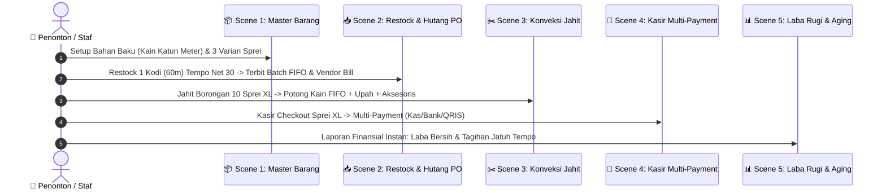

# 🎬 STORYBOARD & NASKAH VIDEO MOTION TUTORIAL
## Alur Lengkap Sistem POS, Inventori FIFO, Konveksi & Akuntansi Invo. (Odoo 20.0 Enterprise)

---

## 📌 Dokumen Meta Video

| Parameter | Spesifikasi |
| :--- | :--- |
| **Judul Video** | Tutorial Alur Lengkap: Dari Bahan Baku Mentah, Konveksi Jahit, Kasir POS hingga Laporan Finansial |
| **Durasi Target** | **75 Detik** (~2.250 Frames pada 30 FPS) |
| **Format Resolusi** | **1920 × 1080 (16:9 Full HD)** & Mendukung Versi Reel **1080 × 1920 (9:16)** |
| **Engine Animasi** | **Remotion (React + TypeScript)** |
| **Gaya Desain Visual** | Invo. Modern SaaS UI Theme (Electric Blue `#1a62ff`, Slate `#0f172a`, Glassmorphism, Spring Motion) |
| **Audio & SFX** | Background Music Modern Tech Upbeat, Pop-in UI SFX, Cash Register Chime, Cashier Scan Beep |

---

## 🎞️ Pembagian Adegan (Scene Breakdown & Motion Script)



---

### 🎬 Scene 1: Katalog Master Barang & Multi-Satuan (00:00 - 00:15)
* **Durasi:** 15 Detik (Frames 0 – 450)
* **Tujuan Edukasi:** Menunjukkan kemudahan setup 1 barang mentah yang memiliki banyak satuan jual eceran (*single-flow setup*).
* **Komposisi Visual:**
  * Background gelap elegan (`#090d16`) dengan partikel biru halus menyala.
  * Window wrapper bertema macOS 3-dots muncul dengan efek *spring bounce*.
  * Menampilkan kartu master barang: **Kain Katun Sprei "XXX"** (Satuan Dasar: **Meter**).
  * Di bawahnya, secara sekuensial muncul 3 kartu varian dengan animasi meluncur (*slide-in*):
    1. `Sprei M` (Kebutuhan: 2.0 Meter | Manual Rp 60.000)
    2. `Sprei L` (Kebutuhan: 2.5 Meter | Margin 40% $\rightarrow$ Rp 70.000)
    3. `Sprei XL` (Kebutuhan: 3.0 Meter | Margin 50% $\rightarrow$ Rp 90.000)
* **Teks On-Screen (Subtitle Kinetik):**
  > *"Langkah 1: Cukup setup 1 barang induk, sistem otomatis menghitung konversi satuan dasar meter ke pecahan varian sprei!"*
* **SFX:** Soft whoosh saat kartu muncul, pop sound saat badge satuan aktif.

---

### 🎬 Scene 2: Pembelian Grosir Inbound, FIFO Batch & Hutang Net 30 (00:15 - 00:32)
* **Durasi:** 17 Detik (Frames 450 – 960)
* **Tujuan Edukasi:** Menjelaskan restock satuan besar grosir yang dikonversi ke meter, pembentukan kartu batch FIFO, serta pencatatan tagihan hutang tempo 30 hari.
* **Komposisi Visual:**
  * Transisi kamera bergeser ke formulir **Pembelian & Restock Inbound** (`PO-202611-0001`).
  * Supplier: `PT. Tekstil Maju Jaya`.
  * Pembelian: `1 Kodi` seharga `Rp 1.200.000`.
  * Animasi kalkulasi angka berjalan:
    $$1\text{ Kodi} \times 60 = 60\text{ Meter} \quad\longrightarrow\quad \text{HPP Dasar} = \frac{\text{Rp } 1.200.000}{60\text{ m}} = \mathbf{\text{Rp } 20.000/\text{m}}$$
  * Di samping kanan, kartu **Batch 1 Persediaan FIFO** terbit secara bercahaya (60 Meter @ Rp 20.000).
  * Di samping kiri, muncul badge merah **Hutang Tempo Net 30 Days** dengan tanggal jatuh tempo `2026-12-01` dan dokumen **Vendor Bill AP** (`Draft Bill`).
* **Teks On-Screen:**
  > *"Langkah 2: Restock grosir otomatis terkonversi ke satuan meter gudang, mencatat batch FIFO tertua, dan menerbitkan tagihan hutang supplier 30 hari!"*
* **SFX:** Typing sound, stamp confirmation sound saat status berubah ke "DONE".

---

### 🎬 Scene 3: Konveksi Make-to-Stock & HPP Komposit Sprei Jadi (00:32 - 00:50)
* **Durasi:** 18 Detik (Frames 960 – 1500)
* **Tujuan Edukasi:** Menampilkan proses jahit borongan sprei yang memotong stok kain FIFO dan mengunci HPP komposit ke kuota fisik rak toko.
* **Komposisi Visual:**
  * Layar membuka menu **✂️ Produksi & Jahit Sprei** (`PRD-202611-0001`).
  * Input: `10 pcs Sprei XL`.
  * Animasi grafis gunting memotong kain:
    * $10\text{ pcs} \times 3\text{ Meter} = 30\text{ Meter}$ terpotong dari Batch 1 FIFO.
  * Kartu breakdown biaya muncul bertingkat:
    * 🧵 Bahan Kain (30m @ Rp 20rb) = **Rp 600.000**
    * ✂️ Ongkos Jahit Borongan (10 pcs @ Rp 10rb) = **Rp 100.000**
    * 📦 Aksesoris Karet & Plastik (10 pcs @ Rp 5rb) = **Rp 50.000**
    * **Total Biaya Produksi:** **Rp 750.000** $\rightarrow$ **HPP Sprei Jadi: Rp 75.000 / pcs**
  * Animasi panah melesat ke rak toko:
    * Varian Sprei XL berubah status menjadi **`Physical Allocation (Allocated)`**.
    * Kuota fisik rak bertambah **+10 Pcs Siap Jual** dengan harga jual margin 50% = **Rp 112.500**.
* **Teks On-Screen:**
  > *"Langkah 3: Jahit borongan sprei otomatis memotong meteran kain FIFO, mengakumulasi upah jahit dan aksesoris menjadi HPP komposit, dan memindahkannya ke rak toko!"*
* **SFX:** Scissors cutting sound, register bell.

---

### 🎬 Scene 4: Transaksi Kasir POS & Multi-Payment Split (00:50 - 01:08)
* **Durasi:** 18 Detik (Frames 1500 – 2040)
* **Tujuan Edukasi:** Pengalaman kasir super cepat, kalkulasi subtotal instan, dan split jurnal keuangan otomatis (Kas, Bank, QRIS).
* **Komposisi Visual:**
  * Layar beralih ke antarmuka **🛒 POS Kasir & Transaksi**.
  * Kasir memilih `Sprei XL`, input Qty: `1 pcs`.
  * Kolom harga langsung terisi otomatis `Rp 112.500`.
  * Kasir mengklik tombol pembayaran:
    * Pilihan metode muncul berdampingan: **💵 CASH**, **🏦 BANK TRANSFER**, **📱 QRIS**.
    * Saat memilih QRIS: Tampil QR code bercahaya, transaksi diverifikasi lunas.
    * Animasi alur dana membelah 3:
      * CASH $\rightarrow$ `Buku Kas Toko (CSH1)`
      * TRANSFER $\rightarrow$ `Rekening Bank Bisnis (BNK1)`
      * QRIS $\rightarrow$ `Kliring Merchant H+1 (QRIS1)`
    * Stok rak Sprei XL seketika berkurang dari 10 pcs menjadi **9 pcs**.
* **Teks On-Screen:**
  > *"Langkah 4: Kasir checkout dalam hitungan detik! Mendukung pembayaran Cash, Transfer, dan QRIS dengan pemisahan buku akun otomatis!"*
* **SFX:** Barcode scan beep, POS receipt printing sound.

---

### 🎬 Scene 5: Laporan Finansial, Laba Bersih & Aging Hutang (01:08 - 01:25)
* **Durasi:** 17 Detik (Frames 2040 – 2250)
* **Tujuan Edukasi:** Memberikan gambaran ringkas bagaimana seluruh aktivitas hulu-ke-hilir bermuara ke laporan laba rugi bersih dan kontrol likuiditas bisnis.
* **Komposisi Visual:**
  * Tampilan dashboard analitik dengan grafik batang vertikal dan kartu KPI bercahaya:
    * **Total Omzet:** Rp 112.500
    * **HPP Terkunci (COGS):** Rp 75.000
    * **Laba Kotor Penjualan:** Rp 37.500
    * **Beban Kemasan:** Rp 15.000
    * **Laba Bersih Toko:** **Rp 22.500** *(Hijau bersinar)*
  * Widget kalender jatuh tempo hutang:
    * Menampilkan pengingat tagihan `PT. Tekstil Maju Jaya` (Jatuh tempo 1 Desember 2026).
  * Penutup: Logo 3D **Invo. POS Enterprise** dengan tombol aksi CTA:
    > *"Sistem Siap Digunakan di Odoo Enterprise Cloud (`sage.odoo.com`). Teruji, Terintegrasi, dan Presisi!"*
* **Teks On-Screen:**
  > *"Laporan Laba Rugi dan Pengingat Jatuh Tempo Hutang tersaji otomatis dan real-time. Bisnis Anda berjalan rapi tanpa pembukuan ganda!"*
* **SFX:** Inspiring chord crescendo, subtle chime.

---

## 🛠️ Langkah Teknis Pembuatan Video di Remotion

Proyek video motion ini akan disusun menggunakan komponen Remotion berikut:
1. **Composition Setup:** `1920x1080`, 30 fps, 2250 frames.
2. **Komponen Modular:**
   - `<MacWindow />`: Frame desktop macOS dengan 3 colored dots dan dynamic title.
   - `<MetricCard />`: Kartu statistik dengan animasi counter angka `spring()`.
   - `<FlowArrow />`: Garis panah berpendar yang menghubungkan antar modul.
   - `<ReceiptStruk />`: Mockup struk belanja yang tercetak ke bawah.
   - `<BadgePill />`: Indikator status berwarna hijau, kuning, dan merah.
3. **Perintah Render Video MP4:**
   ```bash
   npx remotion render src/index.ts InvoPosTutorial out/invo_pos_tutorial.mp4
   ```
